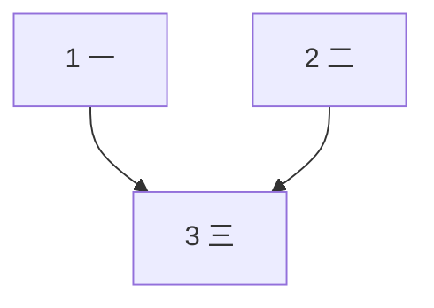

# YUIBoard ドキュメント規約

[English](CONVENTION.md) · [中文](CONVENTION.zh-CN.md) · **日本語**

YUIBoard はリポジトリ内の計画ドキュメント（`tasks.md`、ADR）、GitHub の PR、ローカルの AI セッション記録を読み取り専用で読み、各タスクの状態を推定します。ドキュメントと PR タイトルを以下の 8 項目に沿って書けば、タスク・関係・見積もり・PR を YUIBoard が正しく対応づけられます。

- 各項目はまず**推奨の書き方**、次に**互換で認識される既存の書き方**を示します（古いドキュメントを書き直す必要はありません）。
- 規約に合わなくてもエラーで止まることはありません。タスクはそのまま表示され、認識できた部分は通常どおり推定に使われます。診断ページの「規約違反」に、何番の項目か、どのドキュメントの何行目か、どの PR かが表示されます。
- YUIBoard のサービスはリポジトリ内のファイルを一切変更しません。AI にもこの規約で書かせたい場合は、末尾の「AI 向けの短い説明」を参照してください。
- 以下のコードブロックの例はすべて `test/convention.test.mjs` がパーサーに通して検証しているため、例を変えるとテストで確認されます。
- 英語・中国語で書く場合は、各項目の「**English / 中文**」に挙げた同等のキーワードを使えば日本語と同じように認識されます（英語は大文字小文字を区別しません）。混在も可能です。

## 1. タスク行

**推奨**：`- [ ] <番号> <タイトル>`、完了したら `[x]` に変えます。番号は `1`、`1.1`、`2.10`、`2.5b` のように書けます。親子関係はインデントではなく番号で決まります（`2.5b` の親は `2`）。

```markdown
# 例：タスク行
## フェーズ 1
- [ ] 1 骨組みを作る
- [x] 1.1 設定の読み込み
- [ ] 2 パーサー
- [ ] 2.5b サブタスクを追加
- [ ] 2.10 10 番目のサブタスク
```

**互換**：番号末尾のドット（`1.`）、番号ごとタイトル全体を太字、`T` 接頭辞（`T1` と `1` は同じ番号）、番号前の `タスク`（`- [ ] タスク 1 骨組みを作る`）。

```markdown
# 例：互換のタスク行
- [ ] 1. 番号の末尾にドット
- [ ] **1.1 全体を太字にしたタスク**
- [ ] T2 T 接頭辞付き
```

タスク行が 1 行もない場合に限り、`タスク N：` / `TN:` で始まる見出しをタスクとして扱います（旧来の書き方の救済）：

```markdown
# 例：見出し形式のタスク
## タスク 1：見出し形式の最初のタスク
- [x] 手順その一
- [x] 手順その二
## タスク 2：見出し形式の二つ目のタスク
- [ ] 手順その一
```

**English / 中文**：タスク行の書き方は同じです（`- [ ] 1 Scaffold`）。番号の前に `Task` を付けても構いません。見出し形式のタスクは `### Task 1:` も認識します。

**黙って無視せず報告する書き方**：タスク行があるドキュメントでは、`### タスク 1：`、`### 任务 1：` のような見出しはタスクとして扱われず、診断ページの「規約違反」でタスク行への書き換えを提案します。`- [ ] task 2`（小文字）、`- [ ] ２ タイトル`（全角数字）も書き方の誤ったタスク行として報告します。

**plan / TODO ディレクトリ**：`md-dir` ソースとして設定したディレクトリ（例：`docs/superpowers/plans`、`03.PLAN`、`00.todolist`）では、その階層の各 `.md` が 1 つのドキュメントになり、ファイル名がドキュメント名です。書き方は上と同じです。superpowers 形式の `### Task N:` + `- [ ] **Step N:**` は上記の見出し形式のタスクとして扱い、Step がすべてチェックされて初めてその Task が完了です。タスク行が 1 行もないファイルは「計画中（タスクなし）」と表示され、規約違反にはなりません。タスク行に似ているのに書式が違う行は通常どおり指摘されます。

## 2. グループ / マイルストーン

**推奨**：`### マイルストーン <コード>：<説明>`。コードはドキュメント内で一意にします（例：`M1`、`M0-c`）。グループ見出しから最初のタスクまでの説明文に、グループ全体の依存や並行を書けます。主語はそのグループの全タスクです。

```markdown
# 例：マイルストーン
### マイルストーン M1：基盤
- [ ] 1 骨組みを作る
### マイルストーン M2：機能
> 本グループは M1 に依存。
- [ ] 2 機能 A
- [ ] 3 機能 B
```

**互換**：`## フェーズ 1` のようなグループ見出しは、グループの別名として参照できます（`フェーズ 1 に依存`）。

**English / 中文**：`### Milestone M1: …` / `### 里程碑 M1：…`。グループ別名は `Phase 1`、`Stage 1`、`阶段 1`（漢数字の `## 阶段一`、`## 第二阶段` は `阶段 1`、`阶段 2` と同じ別名）。

## 3. 依存 / 並行 / 順序

認識するのは 2 か所だけです：**タスクタイトルの括弧内**と、**「依存 / 前提タスク / 並行 / 順序」で始まる本文行**（加えて項目 2 のグループ説明文）。それ以外の本文の記述（「要件 1.3 はこれに依存する」）は依存になりません。

**推奨**：

```markdown
# 例：関係の書き方
### マイルストーン M1：基盤
- [ ] 1 一（依存：なし）
- [ ] 2 二
- [ ] 2.1 二の一
- [ ] 2.2 二の二
- [ ] 2.3 二の三
- [ ] 2.4 二の四
- [ ] 3 三（1 と 2.1 に依存）
### マイルストーン M2：機能
- [ ] 4 四（2.1〜2.4 に依存）
- [ ] 5 五（M1 に依存）
- [ ] 6 六（3 に依存；4、5 と並行可）
- [ ] 7 七
- [ ] 7.1 七の一（7.1〜7.3 は並行可）
- [ ] 7.2 七の二
- [ ] 7.3 七の三
- [ ] 8 八（8.1、8.2、8.3 を順に）
- [ ] 8.1 八の一
- [ ] 8.2 八の二
- [ ] 8.3 八の三
- [ ] 9 九（other-spec#3 に依存）
- [ ] 11 十一
  - 順序：11.1 → 11.2 → 11.3 / 11.4 → 11.5
- [ ] 11.1 十一の一
- [ ] 11.2 十一の二
- [ ] 11.3 十一の三
- [ ] 11.4 十一の四
- [ ] 11.5 十一の五
```

- 列挙の区切りは `、`、`と`、`/`、`+`。範囲は `〜` か長いダッシュ / ハイフン（`2.1〜2.4`、`2.1–2.4`、`2.1-2.4`）、またはチルダ（`1~3`、`1～3`）で、同じ親・同じ階層に実在するタスクだけに展開されます。
- `2.x` または親タスクの番号 = すべてのサブタスク。`<spec 名>#<番号>` で別ドキュメントのタスクを参照します。
- 外部の前提条件は `P1 が必要` と書き、ドキュメント冒頭の前提条件表に登録します。解消したら番号に取り消し線を引く（`~~P1~~`）か、事項に「解決済み」と書きます。

```markdown
# 例：前提条件表
## 前提条件
| ID | 事項 | ブロック |
|---|---|---|
| P1 | 検証環境の申請 | 10 |
| ~~P2~~ | API キーの取得 | ブロックしない |
| P3 | ドメインの決定（解決済み） | なし |
## タスク
- [ ] 10 デプロイ（P1 が必要）
```

キーワード付きの書き方だけを認識します。英語の `after` / `requires` は普通の文でもよく使われるため、コロン付き、`task` 付き、または参照の直後で節が終わる / `is done` が続く場合に限り認識します：

| 日本語 | English | 中文 |
|---|---|---|
| `依存：X`、`X に依存`、`前提タスク X` | `depends on X`、`Depends: X`、`blocked by X`、`requires X`、`after X is done` | `依赖 X` / `依赖：X` |
| `X の完了後`、`X 完了後` | `after task X` | `X 完成后` |
| `依存：なし` / `依存なし` | `depends on: none` / `no dependencies` | `依赖：无` / `无依赖` |
| `X と並行` / `並行：X` | `parallel with X`、`can run in parallel with X` / `Parallel: X` | `可与 X 并行` / `并行：X` |
| `X は並行可` | `X can run in parallel`、`X in parallel` | `X 可并行` |
| `X を順に`、`X 直列` / `順序：X → Y` | `X in order`、`X sequentially` / `Order: X → Y` | `X 依次` / `串行` / `顺序：X → Y` |
| `X 以降` | `X onward` | `X 起` |
| `P1 が必要` | `needs P1`、`requires P1` | `需要 P1` |
| `タスク N`、`と`、範囲 `2.1〜2.4` | `task N` / `tasks N`、`and`、`&` | `任务 N`、区切り `、` `和` |
| 前提条件表：`ブロック` 列。先頭または括弧内の `解決済み` で、後ろが日付か「：説明」だけのもの（`解決済み？`、`解決済みではない` は不可）。`ブロックしない` / `なし` | `Blocks` 列。セル先頭または括弧内の `resolved` / `(done)` で、後ろが日付か「: note」だけのもの（`not resolved`、`resolved?`、`resolved: no` は不可）。`non-blocking` / `none` | `阻塞` 列、`已决`、`不阻塞` / `无` |

本文行が `依存` / `前提タスク` / `並行` / `順序` / `Depends` / `Requires` / `After` / `Blocked by` / `Parallel` / `Order` / `依赖` / `前置` / `并行` / `顺序` で始まる場合も同様に認識します。英語の文は `. `（後ろが大文字）か `;` で区切られます。日本語の `、` は、両側にそれぞれ関係を表す語があるときだけ節を区切り（`1 に依存、3 と並行`）、そうでなければ単なる列挙です（`P1 のキー、P2 のアカウントが必要`）。

```markdown
# 例：英語の関係表記
| ID | Item | Blocks |
|---|---|---|
| P1 | Test environment | 6 |
| P2 | API key (done) | none |
### Milestone M1: Foundation
- [ ] 1 Scaffold (depends on: none)
- [ ] 2 Parser
- [ ] 2.1 Lexer
- [ ] 2.2 Grammar
- [ ] 3 Config (depends on 1 and 2.1)
### Milestone M2: Features
> 5 onward depends on M1.
- [ ] 4 Docs (parallel with 3)
- [ ] 5 UI
- [ ] 5.1 Layout (5.1–5.3 can run in parallel)
- [ ] 5.2 Theme
- [ ] 5.3 Icons
- [ ] 6 Deploy (needs P1; 2.1 / 2.2 in order)
  - Depends on: 5
```

```markdown
# 例：中国語の関係表記
| 编号 | 事项 | 阻塞 |
|---|---|---|
| P1 | 测试环境 | 6 |
| P2 | API key（已决） | 无 |
### 里程碑 M1：地基
- [ ] 1 骨架（依赖：无）
- [ ] 2 解析器
- [ ] 2.1 词法分析
- [ ] 2.2 语法分析
- [ ] 3 配置（依赖 1 和 2.1）
### 里程碑 M2：功能
> 5 起依赖 M1。
- [ ] 4 文档（可与 3 并行）
- [ ] 5 界面
- [ ] 5.1 布局（5.1–5.3 可并行）
- [ ] 5.2 主题
- [ ] 5.3 图标
- [ ] 6 部署（需要 P1；2.1 / 2.2 依次）
  - 依赖：5
```

**互換**：番号の前に「タスク」を付ける書き方（`タスク 1 と 2 に依存`、`依存：タスク 2.4 の avatar prop`、`タスク 3/4 と並行`）、`X の完了後`、`2.5 以降は 1.3 に依存`（2.5 と、同じグループでそれ以降のタスク）、ドキュメント末尾の、ノードがタスク番号で始まる Mermaid 依存グラフ（`A --> B` は B が A に依存と読む。ノードの半数超がタスクに対応する場合だけ採用）。

````markdown
# 例：互換の関係表記
## フェーズ 1
- [ ] 1 一
- [ ] 2 二
- [ ] 2.4 二の四
- [ ] 3 三（タスク 1 と 2 に依存）
- [ ] 4 四（依存：タスク 2.4 の avatar prop）
- [ ] 5 五（タスク 3/4 と並行）
- [ ] 6 六（1 の完了後に着手）


````

## 4. 廃止

**推奨**：行全体に取り消し線を引き、日付と理由を書きます：`- [x] ~~6 タイトル~~ **【廃止 2026-09-01】** 理由`。

**互換**：タイトルに「（廃止）」または「[廃止]」と書く。

```markdown
# 例：廃止
- [x] ~~6 旧方式~~ **【廃止 2026-09-01】** 新方式に切り替え
- [x] 7 （廃止）もう一つの旧方式
- [ ] 8 まだやる作業
```

**English / 中文**：`[void]`、`(obsolete 2026-09-01)`；`【作废 2026-09-01】`、`（作废）`、`[作废]`。

廃止したタスクは集計に含めず、それに依存するタスクはその前提を満たしたものとみなします。

## 5. 見積もり

**推奨**：タスクの下に `**見積もり**：1 日` の行を書きます。`半日`、`2 時間`、`1 時間 + 30 分` も書けます。書かなければ設定のデフォルト工期（1 日）になります。

```markdown
# 例：見積もり
- [ ] 1 一
  - **見積もり**：1 日
- [ ] 2 二
  - **見積もり**：半日
- [ ] 3 三
  - **見積もり**：2 時間
- [ ] 4 四
  - **見積もり**：1 時間 + 30 分
```

**互換**：`見積：`、`所要時間：`。単位 `営業日`、`h`、`min` など、`2〜3 日` のような範囲（上限を採用）。

**English / 中文**：`**Estimate**: 2 days`（`Estimated:`、`Estimated time:` も可。単位は `day(s)` / `d` / `working days` / `hour(s)` / `hr` / `h` / `minute(s)` / `min`）；`**预计耗时**：1 天`（単位は `天` / `工作日` / `小时` / `分钟`、`半天` も可）。認識するのはこの行だけで、本文中の「3 days later」は対象外です。

```markdown
# 例：英語と中国語の廃止と見積もり
- [x] ~~1 Old plan~~ **[void 2026-09-01]** replaced by 2
- [ ] 2 New plan
  - **Estimate**: 1 hour + 30 min
- [x] 3 旧方案【作废 2026-09-01】
- [ ] 4 新方案
  - **预计耗时**：2–3 天
```

## 6. 進行中マーク（任意）

着手したら `- [ ]` を `- [~]` に、マージ後に `- [x]` に変えます（英語・中国語のドキュメントも同じ）。書かなくても構いません。関連する AI セッションや PR があれば YUIBoard が進行中と判断します。

```markdown
# 例：進行中
- [~] 2.5b 作業中
```

## 7. PR タイトル

**推奨**：タイトルに `タスク <番号>` かマイルストーンのコードを書きます。複数のドキュメントで番号が重なる場合は `<spec 名>#<番号>` と書きます。

```text
feat(devboard): タスク 1.2 tasks.md のタスク行を解析
[V2] docs(api): タスク 15.2 ドキュメントを追加
[V2] feat(api): M0-c スペース実行
[V2] 受け入れとデプロイ確認を整備（タスク 13、14（一部））
fix: devboard-mvp#3.4 関連付けを修正
feat: Tasks 3 and 4 add parser
feat: 任务 5 和 6 实现解析
```

**English / 中文**：`Task N` / `Tasks N and M`、`任务 N`。一部だけの場合は `(partial)` / `(part)` / `（部分）` / `（部分完成）`、または末尾の `部分`（`fix: Task 13 (partial)`、`fix: 任务 13（部分）`、`fix: 任务 52 部分`）。

**番号だけでは認識しません**：`fix: 3 件のバグを修正` の 3 はタスク 3 とはみなされません。

**ADR は略称でも書けます**：ADR のドキュメント名はファイル名全体（例：`ADR-0033-engine-upgrade`）ですが、タイトルに `ADR-0033#64` や `ADR-0033` と書いても認識します。ただし、その PR のブランチラインのドキュメントに番号 0033 の ADR が 1 本だけの場合に限ります。複数ある場合（番号の重複や、別のブランチラインの同名ドキュメントも候補に入っている場合）はあいまいとして報告するので、ドキュメント名を省略せずに書いてください。

**参照に見えるのに一致しない書き方は報告します**：タイトルのタスクキーでドキュメント名の大文字小文字が違う場合（`Devboard-MVP#3`）、ADR 番号が存在しない場合（`ADR-0099#3`）、ドキュメントのマイルストーンコードと同じ形なのに存在しないコード（ドキュメントには `M0-c`、タイトルは `M0-z`）がある場合、YUIBoard は説明文には戻らず、「要確認」と診断ページの「規約違反」に書き換え案とともに報告します。それ以外の `<名前>#<番号>` は多くが別リポジトリの issue / PR なので（`other-vendor#127`、`PR#12`、`owner/repo#12`）、対象外です。

**タイトルにタスク番号がないと、説明文のタスク番号はすべて納品扱いになります**：タイトルにタスクへの参照が一つもないときに限り、YUIBoard は PR の説明文から参照を探します。その際、説明文に出てくるタスク番号やマイルストーンのコードはすべてこの PR で納品したものとみなされます。「未完了：タスク 13 は検証が残っている」「M0-c の下準備」といった背景説明や、書き方の例も含みます。ですから、納品したタスクはタイトルに書いてください。タイトルに参照があれば説明文は見ないので、残作業をどう書いても影響しません。本当にタスクに対応しない PR（main の取り込み、CI 調整、ルール文書の修正）では説明文にタスク番号をなるべく書かず、書いた場合はボード上で手動で関連を外してください。

**関連づけ = 完全な納品ではありません**：タスクが完了と数えられるのは、tasks.md でチェックされていて、open または未同期の PR がない場合だけです。未チェックで関連 PR がマージ済みなら「進行中」です。タイトル・説明文・マイルストーン・手動関連のいずれもドキュメントでの確認の代わりにはなりません。ローカル同期状態が不明な場合も従来の扱いのとおりチェック済みが前提で、有効な PR がなければチェック済みでも「ドキュメントのみ確認」です。

**一部だけ対応した場合**：参照の直後に「一部」マークを付けると、部分納品の根拠とラベルが残ります。認識するマーク：`（一部）` / `(一部)`、`（部分）`、`（部分完成）`、`(partial)`、`(part)`、および括弧なしで後ろに文字が続かない `部分`（`任务 52 部分`、`任务 99，部分`。`任务 1，部分页面改版` は対象外）。マークは直前の参照にかかります：`タスク N` のリストは全体（`タスク 13、14（一部）` は両方とも一部）、タスクキーはそれ自身だけ（`devboard-mvp#3.4（一部）`）、マイルストーンのコードに付けるとそのコードが展開するグループ全体が一部になります（`M0-c（一部）`）。個別に付けるときは各項目に「タスク」が必要です：`タスク 13（一部）、タスク 14（一部）`。`タスク 13（一部）、14（一部）` と書くと 13 しか認識されません。同じ場所（タイトルまたは説明文）で同じタスクを完全・一部の両方で参照した場合は一部として扱います。説明文から参照を探す場合も同じマークを認識します。部分 PR も open / 未同期の確認対象です。通常の関連 PR を追加しても、手動関連に切り替えても、未チェックのタスクは完了になりません。

```text
[V2] fix(api): 受け入れプローブ（タスク 13（一部））
fix: devboard-mvp#3.4（一部）
[V2] feat(api): M0-c（一部）
```

**任意の補足**：PR の説明文に `Task: <spec 名>#<番号>` の 1 行を書く、またはブランチ名に `task-<番号>` やマイルストーンのコードを含める。ブランチ名はタイトルと説明文のどちらにも参照がないときだけ使います。

```text
Task: devboard-mvp#2.5b
```

```branch
devboard/task-1.2
feature-m0c
```

## 8. タスク本文の Markdown

YUIBoard はタスクのタイトル、グループ見出し、タスク本文を Markdown のサブセットで表示します。ドキュメント内の HTML がページの要素になることはありません。

- **描画されるもの**：インデントで入れ子になるリスト（`-`、`*`、`+`、`1.`、`[ ]` / `[x]` / `[~]` のチェックボックスを含む）、フェンス付きコードブロック（`` ``` `` または `~~~`）、引用（連続する `>` 行。中にリストを書けます）、GFM の表（ヘッダー行、`|---|` の区切り行、`:` で揃え位置を指定、`\|` で文字どおりの縦線）、インラインの `` `コード` ``、`**太字**`、`~~取り消し線~~`、`_斜体_`、`[テキスト](https://…)` のリンク（それ以外のリンクはテキストのみ表示）。
- **そのまま表示し、指摘もしないもの**：単独の `*` や `~`（`*.mjs`、`cron */5`、`1.2~1.8` はワイルドカードや範囲であり、斜体や取り消し線にはしません）、単語内のアンダースコア（`snake_case`、`__tests__`）、`<id>` や `<docRef>` のようなプレースホルダー。コード内は一切解釈しません。
- **原文のまま表示し「ここは Markdown として表示していません」と示すもの**：タスク本文中の見出し（インデントされた `#### 実測記録` など）、区切り線、画像 ``、脚注 `[^1]`、`<br>`、`<details>`、`` のような HTML タグ。診断ページの「規約違反」に、項目 8 としてそれぞれのドキュメントと行番号が表示されます。書き換えの目安：見出しは太字の行に、区切り線は空行に、画像はリンク `[説明](URL)` に、脚注は本文か括弧内に、HTML は Markdown の書き方かインラインコードにします。

## AI 向けの短い説明

Claude Code に YUIBoard プラグインを入れている場合、セッションがプロジェクトを認識するとプラグインが下の要点を AI に伝えます。AI がタスク文書を書くときや `gh pr create` / `gh pr edit` を実行するときはプラグインがこの規約で確認し、今回の書き込みで新たに入る規約違反を止めて、直してから書かせます（文書に元からある問題は止めません。プラグインの設定 `guard` を `off` にすると無効になります）。

Codex など他のツールでは止められません。下のブロックを対象リポジトリの `AGENTS.md` / `CLAUDE.md` に貼り付けてください。すでに規約から外れている書き方は、AI に `devboard-fix-convention` スキルで診断ページに沿って 1 件ずつ直させることができます。変更は 1 か所ごとにあなたの確認を取ります。

```md
このリポジトリのタスク文書と PR タイトルは YUIBoard（ローカルの進捗ボード）が規約どおりに読み取ります。次のとおりに書いてください：
- タスク行：`- [ ] 番号 タイトル`。完了は `[x]`、作業中は `[~]` でもよい。それ以外のチェックボックスは使わない。廃止は `- [x] ~~6 旧方式~~ **【廃止 2026-09-01】** 理由` と書く。サブタスクの番号は `1.1`（親子は番号で決まり、インデントは見ない）。`### タスク 1：` のような見出しをタスク行の代わりに使わない。
- グループ：`### マイルストーン M1：説明`。コードは文書内で一意。
- 依存：タスクタイトル末尾の括弧に書く。例：`（依存：1、2.1）`、`（依存：2.1–2.4）`、`（依存：M1）`、`（依存：other-spec#3）`。
- PR タイトル：納品したタスクをタイトルに書く。`タスク 3`、`タスク 3.1–3.4`、またはマイルストーンコード。複数の文書で番号が重なるときは `<文書名>#<番号>`。番号だけでは参照とみなさない。一部だけなら `タスク 13（一部）`。ADR の略記 `ADR-0033#64` は ADR-0033 が 1 本だけのときに限り、それ以外は文書名をすべて書く。
- タスク番号：タスク番号を書く前に文書を確認し、文書に実在する番号だけを使う。不確かなら先に調べ、記憶や推測で書かない。
- タスク本文の Markdown は、リスト、チェックボックス、コードブロック、引用、表、太字、斜体、取り消し線、インラインコード、リンクのみ。見出し、区切り線、画像、脚注、HTML タグは使わない。
規約の全文：https://github.com/funnysubaru/yuiboard/blob/main/CONVENTION.ja.md
```
