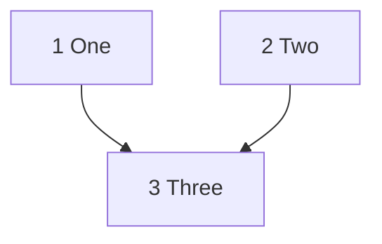

# YUIBoard document conventions

**English** · [中文](CONVENTION.zh-CN.md) · [日本語](CONVENTION.ja.md)

YUIBoard reads planning documents in your repository (`tasks.md`, ADRs), GitHub PRs and local AI session logs, all read-only, and works out the status of every task. Write documents and PR titles following the eight rules below, and YUIBoard can match up tasks, relations, estimates and PRs.

- Each rule shows the **recommended form** first, then the **existing forms that are also accepted** (old documents don't need rewriting).
- Not following a rule never makes anything fail: tasks still show up, whatever can be recognized is still used, and the "Convention issues" section of the Diagnostics page says which rule, which document and line, or which PR.
- The YUIBoard service never changes files in your repository. To have your AI follow these rules too, see "A short brief for AI" at the end.
- Every example in the code blocks below is fed to the parser by `test/convention.test.mjs`, so the tests check any change to the examples.
- For documents in Chinese or Japanese, use the equivalent keywords listed under "**中文 / 日本語**" in each rule; they are recognized just like the English forms (English keywords are case-insensitive), and languages can be mixed.

## 1. Task lines

**Recommended**: `- [ ] <number> <title>`, changed to `[x]` when done. Numbers can be `1`, `1.1`, `2.10`, `2.5b`. Parent/child relationships come from the number (the parent of `2.5b` is `2`), not from indentation.

```markdown
# Example: Task lines
## Phase 1
- [ ] 1 Scaffold
- [x] 1.1 Config loading
- [ ] 2 Parser
- [ ] 2.5b An extra subtask
- [ ] 2.10 The tenth subtask
```

**Also accepted**: a trailing dot after the number (`1.`), the number and title bolded together, a `T` prefix (`T1` and `1` are the same number), and `Task` before the number (`- [ ] Task 1 Scaffold`).

```markdown
# Example: Compatible task lines
- [ ] 1. Number with a trailing dot
- [ ] **1.1 Task bolded as a whole**
- [ ] T2 Number with a T prefix
```

Only when a document has no task lines at all are headings starting with `Task N:` / `TN:` treated as tasks (a fallback for the older style):

```markdown
# Example: Heading-style tasks
## Task 1: First heading-style task
- [x] Step one
- [x] Step two
## Task 2: Second heading-style task
- [ ] Step one
```

**中文 / 日本語**: task lines are written the same way (`- [ ] 1 搭骨架`); the number may be preceded by `タスク`; heading-style tasks also accept `### タスク 1：`.

**Reported, not silently ignored**: in a document that already has task lines, headings like `### Task 1:` or `### 任务 1：` are not treated as tasks; the "Convention issues" section of the Diagnostics page suggests rewriting them as task lines. `- [ ] task 2` (lowercase) and `- [ ] ２ Title` (full-width digits) are also reported as malformed task lines.

**plan / TODO directories**: in a directory configured as an `md-dir` source (e.g. `docs/superpowers/plans`, `03.PLAN`, `00.todolist`), each `.md` file at that level is one document named after the file, written as above. The superpowers style `### Task N:` + `- [ ] **Step N:**` is read as heading-style tasks, and a Task is done only when all its Steps are checked. A file with no task lines is shown as "Planning (no tasks yet)" and does not count as a convention issue; lines that look like task lines but are malformed are still reported.

## 2. Groups / milestones

**Recommended**: `### Milestone <code>: <description>`, with a code unique within the document (e.g. `M1`, `M0-c`). The text between a group heading and its first task can state dependencies or parallelism for the whole group; its subject is every task in the group.

```markdown
# Example: Milestones
### Milestone M1: Foundation
- [ ] 1 Scaffold
### Milestone M2: Features
> This group depends on M1.
- [ ] 2 Feature A
- [ ] 3 Feature B
```

**Also accepted**: group headings such as `## Phase 1` or `## Stage 2` can be referenced as group aliases (`depends on Phase 1`).

**中文 / 日本語**: `### 里程碑 M1：…` / `### マイルストーン M1：…`; group aliases `阶段 1`, `フェーズ 1` (Chinese numerals `## 阶段一`, `## 第二阶段` are the same aliases as `阶段 1`, `阶段 2`).

## 3. Dependencies / parallel / order

Relations are read in only two places: **inside the parentheses of a task title**, and **body lines that start with Depends / Requires / After / Blocked by / Parallel / Order** (plus the group notes from rule 2). Narrative elsewhere ("requirement 1.3 depends on it") never becomes a dependency.

**Recommended**:

```markdown
# Example: Relations
### Milestone M1: Foundation
- [ ] 1 One (depends on: none)
- [ ] 2 Two
- [ ] 2.1 Two-one
- [ ] 2.2 Two-two
- [ ] 2.3 Two-three
- [ ] 2.4 Two-four
- [ ] 3 Three (depends on 1 and 2.1)
### Milestone M2: Features
- [ ] 4 Four (depends on 2.1–2.4)
- [ ] 5 Five (depends on M1)
- [ ] 6 Six (depends on 3; can run in parallel with 4 and 5)
- [ ] 7 Seven
- [ ] 7.1 Seven-one (7.1–7.3 can run in parallel)
- [ ] 7.2 Seven-two
- [ ] 7.3 Seven-three
- [ ] 8 Eight (8.1 / 8.2 / 8.3 in order)
- [ ] 8.1 Eight-one
- [ ] 8.2 Eight-two
- [ ] 8.3 Eight-three
- [ ] 9 Nine (depends on other-spec#3)
- [ ] 11 Eleven
  - Order: 11.1 → 11.2 → 11.3 / 11.4 → 11.5
- [ ] 11.1 Eleven-one
- [ ] 11.2 Eleven-two
- [ ] 11.3 Eleven-three
- [ ] 11.4 Eleven-four
- [ ] 11.5 Eleven-five
```

- List separators: `,`, `and`, `&`, `/`, `+`. Ranges use an en dash or hyphen (`2.1–2.4`, `2.1-2.4`) or a tilde (`1~3`, `1～3`) and only expand to existing tasks with the same parent at the same level.
- `2.x` or the parent number = all its subtasks; `<spec name>#<number>` refers to a task in another document.
- Write external prerequisites as `needs P1` and register them in the prerequisites table at the top of the document. To clear one, strike out its ID (`~~P1~~`) or mark the item `resolved`.

```markdown
# Example: Prerequisites table
## Prerequisites
| ID | Item | Blocks |
|---|---|---|
| P1 | Request a test environment | 10 |
| ~~P2~~ | Get an API key | non-blocking |
| P3 | Pick a domain (resolved) | none |
## Tasks
- [ ] 10 Deploy (needs P1)
```

Only phrasing with a keyword counts. `after` and `requires` are too common in ordinary English, so they count only with a colon, with `task`, or when the reference ends the clause or is followed by `is done`:

| English | 中文 | 日本語 |
|---|---|---|
| `depends on X`, `Depends: X`, `blocked by X`, `requires X`, `after X is done` | `依赖 X` / `依赖：X` | `依存：X`, `X に依存`, `前提タスク X` |
| `after task X` | `X 完成后` | `X の完了後`, `X 完了後` |
| `depends on: none` / `no dependencies` | `依赖：无` / `无依赖` | `依存：なし` / `依存なし` |
| `parallel with X`, `can run in parallel with X` / `Parallel: X` | `可与 X 并行` / `并行：X` | `X と並行` / `並行：X` |
| `X can run in parallel`, `X in parallel` | `X 可并行` | `X は並行可` |
| `X in order`, `X sequentially` / `Order: X → Y` | `X 依次` / `串行` / `顺序：X → Y` | `X を順に`, `X 直列` / `順序：X → Y` |
| `X onward` | `X 起` | `X 以降` |
| `needs P1`, `requires P1` | `需要 P1` | `P1 が必要` |
| `task N` / `tasks N`, `and`, `&` | `任务 N`, list separators `、` `和` | `タスク N`, `と`, ranges `2.1〜2.4` |
| Prerequisites table: a `Blocks` column; `resolved` / `(done)` at the start of a cell or in parentheses, followed only by a date or ": note" (`not resolved`, `resolved?`, `resolved: no` don't count); `non-blocking` / `none` | `阻塞` column, `已决`, `不阻塞` / `无` | `ブロック` column; `解決済み` at the start or in parentheses, followed only by a date or "：説明" (`解決済み？`, `解決済みではない` don't count); `ブロックしない` / `なし` |

Body lines starting with `Depends` / `Requires` / `After` / `Blocked by` / `Parallel` / `Order` / `依赖` / `前置` / `并行` / `顺序` / `依存` / `前提タスク` / `並行` / `順序` are read the same way. English sentences are split at `. ` (followed by a capital letter) or `;`. A Japanese `、` splits clauses only when both sides contain a relation word (`1 に依存、3 と並行`); otherwise it is just a list (`P1 のキー、P2 のアカウントが必要`).

```markdown
# Example: Chinese relations
| 编号 | 事项 | 阻塞 |
|---|---|---|
| P1 | 测试环境 | 6 |
| P2 | API key（已决） | 无 |
### 里程碑 M1：地基
- [ ] 1 骨架（依赖：无）
- [ ] 2 解析器
- [ ] 2.1 词法分析
- [ ] 2.2 语法分析
- [ ] 3 配置（依赖 1 和 2.1）
### 里程碑 M2：功能
> 5 起依赖 M1。
- [ ] 4 文档（可与 3 并行）
- [ ] 5 界面
- [ ] 5.1 布局（5.1–5.3 可并行）
- [ ] 5.2 主题
- [ ] 5.3 图标
- [ ] 6 部署（需要 P1；2.1 / 2.2 依次）
  - 依赖：5
```

```markdown
# Example: Japanese relations
| ID | 事項 | ブロック |
|---|---|---|
| P1 | 検証環境 | 6 |
| P2 | API キー（解決済み） | なし |
### マイルストーン M1：基盤
- [ ] 1 骨組み（依存：なし）
- [ ] 2 パーサー
- [ ] 2.1 字句解析
- [ ] 2.2 構文解析
- [ ] 3 設定（1 と 2.1 に依存）
### マイルストーン M2：機能
> 5 以降は M1 に依存。
- [ ] 4 ドキュメント（3 と並行可）
- [ ] 5 UI
- [ ] 5.1 レイアウト（5.1〜5.3 は並行可）
- [ ] 5.2 テーマ
- [ ] 5.3 アイコン
- [ ] 6 デプロイ（P1 が必要；2.1、2.2 を順に）
  - 依存：5
```

**Also accepted**: `task` / `tasks` before the numbers (`depends on tasks 1 and 2`, `depends on task 2.4's avatar prop`, `parallel with tasks 3/4`, `depends on task 16`); `after task X`; `2.5 onward depends on 1.3` (2.5 and the tasks after it in the same group); a Mermaid dependency graph at the end of the document whose node labels start with task numbers (`A --> B` reads as B depends on A; used only when more than half of the nodes match tasks).

````markdown
# Example: Compatible relations
## Phase 1
- [ ] 1 One
- [ ] 2 Two
- [ ] 2.4 Two-four
- [ ] 3 Three (depends on tasks 1 and 2)
- [ ] 4 Four (depends on task 2.4's avatar prop)
- [ ] 5 Five (parallel with tasks 3/4)
- [ ] 6 Six (starts after task 1)


````

## 4. Void tasks

**Recommended**: strike out the whole line and give the date and reason: `- [x] ~~6 Title~~ **[void 2026-09-01]** reason`.

**Also accepted**: `(void)` or `[void]` in the title; `obsolete` works in place of `void` (`(obsolete 2026-09-01)`).

```markdown
# Example: Void
- [x] ~~6 Old approach~~ **[void 2026-09-01]** switched to the new approach
- [x] 7 (void) Another old approach
- [ ] 8 Still to do
```

**中文 / 日本語**: `【作废 2026-09-01】`, `（作废）`, `[作废]`; `【廃止 2026-09-01】`, `（廃止）`, `[廃止]`.

Void tasks are left out of the counts, and a task that depends on one treats that prerequisite as met.

## 5. Estimates

**Recommended**: a line under the task: `**Estimate**: 1 day`. You can write `0.5 day`, `2 hours`, `1 hour + 30 min`. Without one, the configured default duration (1 day) is used.

```markdown
# Example: Estimates
- [ ] 1 One
  - **Estimate**: 1 day
- [ ] 2 Two
  - **Estimate**: 0.5 day
- [ ] 3 Three
  - **Estimate**: 2 hours
- [ ] 4 Four
  - **Estimate**: 1 hour + 30 min
```

**Also accepted**: `Estimated:` and `Estimated time:`; units `day(s)` / `d` / `working days` / `hour(s)` / `hr` / `h` / `minute(s)` / `min`; ranges such as `2–3 days` (the upper bound is used).

**中文 / 日本語**: `**预计耗时**：1 天` (units `天` / `工作日` / `小时` / `分钟`, also `半天`); `**見積もり**：1 日` (also `見積：`, `所要時間：`; units `日` / `営業日` / `時間` / `分`, ranges like `2〜3 日`). Only this line counts; "3 days later" in body text does not.

```markdown
# Example: Chinese and Japanese void and estimates
- [x] ~~1 旧方案~~ **【作废 2026-09-01】** 改用 2
- [ ] 2 新方案
  - **预计耗时**：1 小时 + 30 分钟
- [x] 3 旧案【廃止 2026-09-01】
- [ ] 4 新案
  - **見積もり**：2〜3 日
```

## 6. In-progress marker (optional)

When work starts, change `- [ ]` to `- [~]`; after merging, change it to `- [x]` (the same in Chinese and Japanese documents). This is optional: when a task has a linked AI session or PR, YUIBoard marks it in progress on its own.

```markdown
# Example: In progress
- [~] 2.5b Working on it
```

## 7. PR titles

**Recommended**: put `Task <number>` or a milestone code in the title; when numbers repeat across documents, write `<spec name>#<number>`.

```text
feat(devboard): Task 1.2 parse task lines in tasks.md
[V2] docs(api): Task 15.2 add docs
[V2] feat(api): M0-c space runtime
[V2] Polish acceptance and deploy checks (Tasks 13 and 14 (partial))
fix: devboard-mvp#3.4 fix linking
feat: 任务 3 和 4 新增解析器
feat: タスク 5 と 6 を実装
```

**中文 / 日本語**: `任务 N`, `タスク N`; for partial work, `（部分）` / `（部分完成）` / `（一部）` or a trailing `部分` (`fix: 任务 13（部分）`, `fix: 任务 52 部分`, `fix: タスク 13（一部）`).

**Bare numbers are not recognized**: the 3 in `fix: 3 bugs` is not taken as task 3.

**ADR short names**: an ADR's document name is its whole file name (e.g. `ADR-0033-engine-upgrade`), but `ADR-0033#64` or `ADR-0033` in a title is also recognized, as long as the documents of the PR's branch line contain exactly one ADR numbered 0033. When there are several (duplicate numbers, or a same-named document from another branch line is also a candidate), it is reported as ambiguous; write the full document name.

**Things that look like references but match nothing are reported**: if a task key in the title has the document name in the wrong case (`Devboard-MVP#3`) or an ADR number that does not exist (`ADR-0099#3`), or a code shaped like the document's milestone codes that does not exist (the document has `M0-c`, the title says `M0-z`), YUIBoard does not fall back to the description; it reports the problem under "Needs attention" and in the "Convention issues" section of the Diagnostics page, with a suggested rewrite. Any other `<name>#<number>` is usually an issue or PR in another repository (`other-vendor#127`, `PR#12`, `owner/repo#12`) and is not counted.

**Without a task number in the title, every task number in the description counts as delivered**: YUIBoard falls back to the PR description only when the title has no task reference, and then every task number and milestone code in the description is treated as delivered by the PR — including background notes like "not done: task 13 still needs verification" or "groundwork for M0-c", and even syntax examples. So put delivered tasks in the title; once the title has a reference the description is ignored, and you can describe remaining work however you like. For PRs that really don't map to a task (syncing main, tweaking CI, editing rule documents), avoid task numbers in the description; if you do include them, unlink them by hand on the board.

**A link is not full delivery**: a task counts as done only when it is checked in tasks.md and has no open or not-yet-synced PR. An unchecked task with a merged linked PR is "In progress"; the title, description, milestone or a manual link cannot replace the check in the document. When local sync status is unknown, the existing fallback still requires the checkbox; a checked task with no valid PR is still "Checked in doc only".

**Partial work**: put a partial marker right after the reference to record that the PR delivers part of it, keeping the evidence and label. Accepted markers: `(partial)`, `(part)`, `（部分）` / `(部分)`, `（部分完成）`, `（一部）`, and a bare `部分` with no text after it (`任务 52 部分`, `任务 99，部分`; `任务 1，部分页面改版` does not count). The marker applies to the reference right before it: a `Task N` list as a whole (`Tasks 13 and 14 (partial)` marks both); a task key only itself (`devboard-mvp#3.4 (partial)`); a milestone code marks every task that code expands to (`M0-c (partial)`). To mark items one by one, each needs `Task`: `Task 13 (partial), Task 14 (partial)`; `Task 13 (partial), 14 (partial)` only recognizes 13. When the same place (title or description) references a task both fully and partially, it counts as partial. The same markers apply when the description is used as the fallback. Partial PRs are also checked for open / not-yet-synced state; adding ordinary linked PRs or switching to a manual link does not make an unchecked task done.

```text
[V2] fix(api): Acceptance probe (Task 13 (partial))
fix: devboard-mvp#3.4 (partial)
[V2] feat(api): M0-c (partial)
```

**Optional extras**: a line `Task: <spec name>#<number>` in the PR description; a branch name containing `task-<number>` or a milestone code. The branch name is used only when neither the title nor the description has a reference.

```text
Task: devboard-mvp#2.5b
```

```branch
devboard/task-1.2
feature-m0c
```

## 8. Markdown in task bodies

YUIBoard displays task titles, group headings and task bodies with a subset of Markdown. HTML in the document is never turned into elements.

- **Rendered**: nested lists (`-`, `*`, `+`, `1.`) with `[ ]` / `[x]` / `[~]` checkboxes; fenced code blocks (`` ``` `` or `~~~`); block quotes (consecutive `>` lines, which may contain lists); GFM tables (header row, `|---|` separator with `:` for alignment, `\|` for a literal pipe); inline `` `code` ``, `**bold**`, `~~strikethrough~~`, `_italic_`, and `[text](https://…)` links (other links show only their text).
- **Kept as written, not flagged**: a single `*` or `~` (`*.mjs`, `cron */5`, `1.2~1.8` are wildcards and ranges, not italic or strikethrough), underscores inside words (`snake_case`, `__tests__`), and placeholders such as `<id>` or `<docRef>`. Nothing inside code is interpreted.
- **Shown as written and marked "not rendered as Markdown here"**: headings inside a task body (such as an indented `#### Notes`), horizontal rules, images ``, footnotes `[^1]`, and HTML tags such as `<br>`, `<details>` or ``. The Diagnostics page lists each one under rule 8 with its document and line. Suggested rewrites: a bold line instead of a heading, a blank line instead of a rule, a link `[text](url)` instead of an image, the note in the text or in parentheses instead of a footnote, and Markdown or inline code instead of HTML.

## A short brief for AI

With Claude Code and the YUIBoard plugin installed, the plugin gives the AI the points below once the session recognizes the project; when the AI writes a task document or runs `gh pr create` / `gh pr edit`, the plugin checks it against this convention and blocks anything off-convention that this write adds, so the AI fixes it first (existing issues in a document are not blocked; set the plugin option `guard` to `off` to turn this off).

Codex and other tools are not blocked: paste the block below into the watched repository's `AGENTS.md` / `CLAUDE.md`. For writing that is already off-convention, the AI can walk the Diagnostics page with the `devboard-fix-convention` skill and fix the items one by one, each change confirmed by you.

```md
Task documents and PR titles in this repository are read by YUIBoard (a local progress board) by its convention; write them as follows:
- Task lines: `- [ ] <number> <title>`; `[x]` when done, `[~]` when void, no other checkboxes; subtasks are numbered `1.1` (parent and child follow the number, not the indentation). Do not use headings such as `### Task 1:` instead of task lines.
- Groups: `### Milestone M1: <description>`, the code unique within the document.
- Dependencies: in parentheses at the end of the task title, e.g. `(depends on 1, 2.1)`, `(depends on 2.1–2.4)`, `(depends on M1)`, `(depends on other-spec#3)`.
- PR titles: put the delivered tasks in the title as `Task 3`, `Tasks 3.1–3.4` or a milestone code; when numbers repeat across documents write `<document>#<number>`; bare numbers are not references. For partial delivery write `Task 13 (partial)`. The ADR short form `ADR-0033#64` works only when there is a single ADR-0033; otherwise write the full document name.
- Markdown in task bodies: only lists, checkboxes, code blocks, quotes, tables, bold, italic, strikethrough, inline code and links; no headings, horizontal rules, images, footnotes or HTML tags.
Full convention: https://github.com/funnysubaru/yuiboard/blob/main/CONVENTION.md
```
