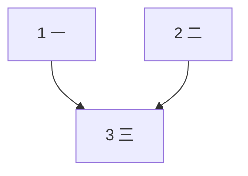

# YUIBoard 文档约定

[English](CONVENTION.md) · **中文** · [日本語](CONVENTION.ja.md)

YUIBoard 只读仓库里的规划文档（`tasks.md`、ADR）、GitHub PR 与本机 AI 会话记录，推算每个任务的状态。文档与 PR 标题照下面八条写，YUIBoard 就能把任务、关系、耗时和 PR 对上号。

- 每条先给**推荐写法**，再列**已兼容的现有写法**（老文档不用改）。
- 写得不符合时不会报错停用：任务照样显示，能认出的部分照常推算，诊断页「不满足约定」会写出是第几条、哪份文档第几行或哪个 PR。
- YUIBoard 服务不改仓库里的任何文件。需要让 AI 也照这套写，见文末「给 AI 的简短说明」。
- 下面代码块里的示例都由 `test/convention.test.mjs` 喂给解析器校验，改示例时测试会跟着检查。
- 英文、日文写文档时用每条下面「**English / 日本語**」列的等价关键词，和中文写法同样识别（英文不分大小写）；可以混写。

## 1. 任务行

**推荐写法**：`- [ ] <编号> <标题>`，完成后改成 `[x]`。编号可以是 `1`、`1.1`、`2.10`、`2.5b`；父子关系看编号（`2.5b` 的父任务是 `2`），不看缩进。

```markdown
# 示例：任务行
## 阶段 1
- [ ] 1 搭骨架
- [x] 1.1 配置加载
- [ ] 2 解析器
- [ ] 2.5b 补一个子任务
- [ ] 2.10 第十个子任务
```

**已兼容**：编号带尾点（`1.`）、编号连同标题整体加粗、`T` 前缀（`T1` 与 `1` 算同一个编号）。

```markdown
# 示例：兼容的任务行
- [ ] 1. 编号带尾点
- [ ] **1.1 整体加粗的任务**
- [ ] T2 带 T 前缀
```

一条任务行都没有时，才把 `Task N:` / `TN:` 开头的标题当任务（老式写法兜底）：

```markdown
# 示例：标题式任务
## Task 1: 标题式的第一个任务
- [x] 步骤一
- [x] 步骤二
## Task 2: 标题式的第二个任务
- [ ] 步骤一
```

**English / 日本語**：任务行写法相同（`- [ ] 1 Scaffold`）；编号前可带 `Task` / `タスク`；标题式任务也认 `### Task 1:` / `### タスク 1：`。

**会被报出来的写法**：已有任务行的文档里，`### 任务 1：`、`### Task 1:` 这类标题不会被当成任务，诊断页「不满足约定」会提示改成任务行；`- [ ] task 2`（小写）、`- [ ] ２ 标题`（全角数字）同样按写法有误的任务行报出。

**plan / TODO 目录**：配置成 `md-dir` 来源的目录（如 `docs/superpowers/plans`、`03.PLAN`、`00.todolist`），这一层的每个 `.md` 算一份文档，文件名就是文档名，写法同上；superpowers 风格的 `### Task N:` + `- [ ] **Step N:**` 按上面的标题式任务认，Step 全勾才算该 Task 完成。一个任务行都没有的文件显示为「规划中（暂无任务）」，不算不满足约定；有像任务行但格式不对的行时照常提示。

## 2. 分组 / 里程碑

**推荐写法**：`### 里程碑 <代号>：<说明>`，代号在文档内唯一（如 `M1`、`M0-c`）。分组标题到第一个任务之间的说明段可以写整组的依赖或并行，主语是本组全部任务。

```markdown
# 示例：里程碑
### 里程碑 M1：地基
- [ ] 1 搭骨架
### 里程碑 M2：功能
> 本组依赖 M1。
- [ ] 2 功能甲
- [ ] 3 功能乙
```

**已兼容**：`## 阶段 1`、`## Phase 2` 这类分组标题，可以当作分组别名来引用（`依赖 阶段 1`）；中文数字的 `## 阶段一`、`## 第二阶段` 与 `阶段 1`、`阶段 2` 是同一个别名。

**English / 日本語**：`### Milestone M1: …` / `### マイルストーン M1：…`；分组别名 `Phase 1`、`Stage 1`、`フェーズ 1`。

## 3. 依赖 / 并行 / 顺序

只在两处认：**任务标题的括号里**，以及**以「依赖 / 前置 / 并行 / 顺序」开头的正文行**（外加第 2 条的分组说明段）。其它正文里的叙述（「需求 1.3 依赖它」）不会变成依赖。

**推荐写法**：

```markdown
# 示例：关系写法
### 里程碑 M1：地基
- [ ] 1 一（依赖：无）
- [ ] 2 二
- [ ] 2.1 二一
- [ ] 2.2 二二
- [ ] 2.3 二三
- [ ] 2.4 二四
- [ ] 3 三（依赖 1、2.1）
### 里程碑 M2：功能
- [ ] 4 四（依赖 2.1–2.4）
- [ ] 5 五（依赖 M1）
- [ ] 6 六（依赖 3；可与 4、5 并行）
- [ ] 7 七
- [ ] 7.1 七一（7.1–7.3 可并行）
- [ ] 7.2 七二
- [ ] 7.3 七三
- [ ] 8 八（8.1 / 8.2 / 8.3 依次）
- [ ] 8.1 八一
- [ ] 8.2 八二
- [ ] 8.3 八三
- [ ] 9 九（依赖 other-spec#3）
- [ ] 11 十一
  - 顺序：11.1 → 11.2 → 11.3 / 11.4 → 11.5
- [ ] 11.1 十一一
- [ ] 11.2 十一二
- [ ] 11.3 十一三
- [ ] 11.4 十一四
- [ ] 11.5 十一五
```

- 列表分隔可用 `、`、`，`、`,`、`/`、`和`、`及`、`与`、`+`；范围用长横或短横（`2.1–2.4`、`2.1-2.4`），也可写 `1~3`、`1～3`，只展开同父同层、实际存在的任务。
- `2.x` 或父任务号 = 全部子任务；`<spec 名>#<编号>` 引用别的文档的任务。
- 外部前置写 `需要 P1`，并在文档开头的前置条件表里登记；解除时把编号划掉（`~~P1~~`）或在事项里写「已决」。

```markdown
# 示例：前置条件表
## 前置条件
| 编号 | 事项 | 阻塞 |
|---|---|---|
| P1 | 申请测试环境 | 10 |
| ~~P2~~ | 拿到 API key | 不阻塞 |
| P3 | 定下域名（已决） | 无 |
## 任务
- [ ] 10 部署（需要 P1）
```

**English / 日本語**（只认带关键词的写法；`after` / `requires` 在英文叙述里太常见，要带冒号、带 `task`、或引用后面就是子句结尾 / `is done` 才算）：

| 中文 | English | 日本語 |
|---|---|---|
| `依赖 X` / `依赖：X` | `depends on X`、`Depends: X`、`blocked by X`、`requires X`、`after X is done` | `依存：X`、`X に依存`、`前提タスク X` |
| `X 完成后` | `after task X` | `X の完了後`、`X 完了後` |
| `依赖：无` / `无依赖` | `depends on: none` / `no dependencies` | `依存：なし` / `依存なし` |
| `可与 X 并行` / `并行：X` | `parallel with X`、`can run in parallel with X` / `Parallel: X` | `X と並行` / `並行：X` |
| `X 可并行` | `X can run in parallel`、`X in parallel` | `X は並行可` |
| `X 依次` / `串行` / `顺序：X → Y` | `X in order`、`X sequentially` / `Order: X → Y` | `X を順に`、`X 直列` / `順序：X → Y` |
| `X 起` | `X onward` | `X 以降` |
| `需要 P1` | `needs P1`、`requires P1` | `P1 が必要` |
| `任务 N`、列表分隔 `、` `和` | `task N` / `tasks N`、`and`、`&` | `タスク N`、`と`、范围 `2.1〜2.4` |
| 前置表：`阻塞` 列、`已决`、`不阻塞` / `无` | `Blocks` 列、单元格开头或括号里的 `resolved` / `(done)`，后面只跟日期或「: 说明」（`not resolved`、`resolved?`、`resolved: no` 不算）、`non-blocking` / `none` | `ブロック` 列、开头或括号里的 `解決済み`，后面只跟日期或「：説明」（`解決済み？`、`解決済みではない` 不算）、`ブロックしない` / `なし` |

正文行以 `Depends` / `Requires` / `After` / `Blocked by` / `Parallel` / `Order` / `依存` / `前提タスク` / `並行` / `順序` 开头时同样认；英文句子之间用 `. `（后接大写）或 `;` 断开；日文的 `、` 只在两侧都写了关系词时断开子句（`1 に依存、3 と並行`），否则只是列举（`P1 のキー、P2 のアカウントが必要`）。

```markdown
# 示例：英文关系写法
| ID | Item | Blocks |
|---|---|---|
| P1 | Test environment | 6 |
| P2 | API key (done) | none |
### Milestone M1: Foundation
- [ ] 1 Scaffold (depends on: none)
- [ ] 2 Parser
- [ ] 2.1 Lexer
- [ ] 2.2 Grammar
- [ ] 3 Config (depends on 1 and 2.1)
### Milestone M2: Features
> 5 onward depends on M1.
- [ ] 4 Docs (parallel with 3)
- [ ] 5 UI
- [ ] 5.1 Layout (5.1–5.3 can run in parallel)
- [ ] 5.2 Theme
- [ ] 5.3 Icons
- [ ] 6 Deploy (needs P1; 2.1 / 2.2 in order)
  - Depends on: 5
```

```markdown
# 示例：日文关系写法
| ID | 事項 | ブロック |
|---|---|---|
| P1 | 検証環境 | 6 |
| P2 | API キー（解決済み） | なし |
### マイルストーン M1：基盤
- [ ] 1 骨組み（依存：なし）
- [ ] 2 パーサー
- [ ] 2.1 字句解析
- [ ] 2.2 構文解析
- [ ] 3 設定（1 と 2.1 に依存）
### マイルストーン M2：機能
> 5 以降は M1 に依存。
- [ ] 4 ドキュメント（3 と並行可）
- [ ] 5 UI
- [ ] 5.1 レイアウト（5.1〜5.3 は並行可）
- [ ] 5.2 テーマ
- [ ] 5.3 アイコン
- [ ] 6 デプロイ（P1 が必要；2.1、2.2 を順に）
  - 依存：5
```

**已兼容**：编号前带「任务」二字（`依赖任务 1、2`、`依赖任务 2.4 的 avatar prop`、`与任务 3/4 并行`、`依赖 task 16`）；`X 完成后`；`2.5 起依赖 1.3`（2.5 及本组其后的任务）；文末节点以任务编号开头的 Mermaid 依赖图（`A --> B` 读作 B 依赖 A；超过一半节点对得上任务才采信）。

````markdown
# 示例：兼容的关系写法
## 阶段 1
- [ ] 1 一
- [ ] 2 二
- [ ] 2.4 二四
- [ ] 3 三（依赖任务 1、2）
- [ ] 4 四（依赖任务 2.4 的 avatar prop）
- [ ] 5 五（与任务 3/4 并行）
- [ ] 6 六（1 完成后开始）


````

## 4. 作废

**推荐写法**：整行划掉并注明日期与原因：`- [x] ~~6 标题~~ **【作废 2026-09-01】** 原因`。

**已兼容**：标题里写「（作废）」或「[作废]」。

```markdown
# 示例：作废
- [x] ~~6 旧方案~~ **【作废 2026-09-01】** 改用新方案
- [x] 7 （作废）另一个旧方案
- [ ] 8 还要做的
```

**English / 日本語**：`[void]`、`(obsolete 2026-09-01)`；`【廃止 2026-09-01】`、`（廃止）`、`[廃止]`。

作废任务不参与统计，依赖它的任务视为这条前置已满足。

## 5. 预计耗时

**推荐写法**：任务下面一行 `**预计耗时**：1 天`。可写 `半天`、`2 小时`、`1 小时 + 30 分钟`；不写按配置的默认工期（1 天）。

```markdown
# 示例：预计耗时
- [ ] 1 一
  - **预计耗时**：1 天
- [ ] 2 二
  - **预计耗时**：半天
- [ ] 3 三
  - **预计耗时**：2 小时
- [ ] 4 四
  - **预计耗时**：1 小时 + 30 分钟
```

**已兼容**：`工作日`、`h`、`分钟` / `min` 等单位，以及 `2–3 天` 这样的区间（取上限）。

**English / 日本語**：`**Estimate**: 2 days`（也认 `Estimated:`、`Estimated time:`；单位 `day(s)` / `d` / `working days` / `hour(s)` / `hr` / `h` / `minute(s)` / `min`）；`**見積もり**：1 日`（也认 `見積：`、`所要時間：`；单位 `日` / `営業日` / `時間` / `分`，区间可写 `2〜3 日`）。只认这一行，正文里的「3 days later」不算。

```markdown
# 示例：英文与日文的作废和耗时
- [x] ~~1 Old plan~~ **[void 2026-09-01]** replaced by 2
- [ ] 2 New plan
  - **Estimate**: 1 hour + 30 min
- [x] 3 旧案【廃止 2026-09-01】
- [ ] 4 新案
  - **見積もり**：2〜3 日
```

## 6. 进行中标记（可选）

开工时把 `- [ ]` 改成 `- [~]`，合并后改 `- [x]`（英文、日文文档相同）。不写也行：有关联的 AI 会话或 PR 时 YUIBoard 会自己判断为进行中。

```markdown
# 示例：进行中
- [~] 2.5b 正在做
```

## 7. PR 标题

**推荐写法**：标题里写 `任务 <编号>` 或里程碑代号；多份文档里编号重复时写 `<spec 名>#<编号>`。

```text
feat(devboard): 任务 1.2 tasks.md 任务行解析
[V2] docs(api): 任务 15.2 补文档
[V2] feat(api): M0-c 空间运行
[V2] 完善验收与部署检查（任务 13、14（部分））
fix: devboard-mvp#3.4 修关联
feat: Tasks 3 and 4 add parser
feat: タスク 5 と 6 を実装
```

**English / 日本語**：`Task N` / `Tasks N and M`、`タスク N`；只做了一部分写 `(partial)` / `(part)` / `（一部）`（`fix: Task 13 (partial)`、`fix: タスク 13（一部）`）。

**裸数字不识别**：`fix: 修 3 个问题` 里的 3 不会被当成任务 3。

**ADR 可写简称**：ADR 的文档名是整个文件名（如 `ADR-0033-engine-upgrade`），标题里写 `ADR-0033#64` 或 `ADR-0033` 也认，前提是这个 PR 所属分支线的文档里只有一篇编号 0033 的 ADR；有多篇（编号重复，或别的分支线的同名文档也在候选里）时报歧义，请写完整文档名。

**像引用却对不上的写法会报出来**：标题里的任务键文档名大小写写错（`Devboard-MVP#3`），或 ADR 编号对不上（`ADR-0099#3`），或写了与文档里代号同形态却不存在的代号（文档里有 `M0-c`，标题写 `M0-z`），YUIBoard 不会退到描述里找，而是在「需要确认」和诊断页「不满足约定」里报出来并给出建议写法。其余 `<名字>#<编号>` 多是别的仓库的 issue / PR（`other-vendor#127`、`PR#12`、`owner/repo#12`），不算。

**标题不写任务号，描述里的任务号都会算成交付**：标题里没有任何任务引用时，YUIBoard 才退到 PR 描述找引用，而描述里出现的任务号、里程碑代号都会被当成本 PR 交付的——包括「未完成：任务 13 仍需补验」「为 M0-c 铺路」这类背景说明，以及写法示例。所以：交付了任务就写进标题，标题一有引用就不再看描述，描述里怎么写剩余事项都不影响；确实不对应任务的 PR（同步 main、调 CI、改规则文档），描述里尽量不写任务号，写了就在看板里手动解除。

**关联不等于完整交付**：任务必须在 tasks.md 勾选，且没有 open 或待同步 PR，才可计入完成。未勾选但有关联 PR 已合并时算「进行中」；标题、描述、里程碑或手动关联都不能替代文档确认。本地同步未知沿用既有降级口径，仍以已勾选为前提；没有有效 PR 时已勾选仍算「仅文档确认」。

**只做了一部分**：在引用后面紧跟「部分」标记，保留部分交付的依据与标签。认这些写法：`（部分）` / `(部分)`、`（部分完成）`、`（一部）`、`(partial)`、`(part)`，以及不带括号、后面不再接文字的 `部分`（`任务 52 部分`、`任务 99，部分`；`任务 1，部分页面改版` 不算）。标记修饰紧挨着它的那一处引用：`任务 N` 列表整条都算部分（`任务 13、14（部分）` 两个都算部分）；任务键只修饰它自己（`devboard-mvp#3.4（部分）`）；里程碑代号带标记时，这个代号展开的整组任务都算部分（`M0-c（部分）`）。逐项标时每项都要带「任务」：`任务 13（部分）、任务 14（部分）`；写成 `任务 13（部分）、14（部分）` 只认得出 13。同一个任务在同一处（标题或描述）里既有完整引用又有部分引用时，按部分算。描述兜底时同样认这些写法。部分 PR 也检查 open / 待同步；增加普通关联 PR 或改成手动关联均不能让未勾选任务变成完成。

```text
[V2] fix(api): 验收探针（任务 13（部分））
fix: devboard-mvp#3.4（部分）
[V2] feat(api): M0-c（部分）
```

**可选补充**：PR 描述里写一行 `Task: <spec 名>#<编号>`；分支名含 `task-<编号>` 或里程碑代号。标题与描述都没有引用时才看分支名。

```text
Task: devboard-mvp#2.5b
```

```branch
devboard/task-1.2
feature-m0c
```

## 8. 任务正文里的 Markdown

YUIBoard 用 Markdown 的一个子集显示任务标题、分组标题与任务正文；文档里的 HTML 一律不变成页面元素。

- **会渲染**：按缩进嵌套的列表（`-`、`*`、`+`、`1.`，含 `[ ]` / `[x]` / `[~]` 复选框）；围栏代码块（`` ``` `` 或 `~~~`）；引用（连续的 `>` 行，里面可以有列表）；GFM 表格（表头行、`|---|` 分隔行，用 `:` 指定对齐，`\|` 表示字面竖线）；行内 `` `代码` ``、`**加粗**`、`~~删除线~~`、`_斜体_`，以及 `[文字](https://…)` 链接（其它链接只显示文字）。
- **照原文、不提示**：单个 `*` 或 `~`（`*.mjs`、`cron */5`、`1.2~1.8` 是通配符与范围，不当斜体或删除线）、词中间的下划线（`snake_case`、`__tests__`），以及 `<id>`、`<docRef>` 这类占位符。代码里的内容一律不解析。
- **照原文显示并标「此处未按 Markdown 渲染」**：任务正文里的标题（例如缩进的 `#### 实测记录`）、分隔线、图片 ``、脚注 `[^1]`，以及 `<br>`、`<details>`、`` 这类 HTML 标签。诊断页「不满足约定」按第 8 条列出每一处的文档与行号。建议改写：标题改成加粗行，分隔线改成空行，图片改成链接 `[说明](地址)`，脚注写进正文或括号，HTML 改成 Markdown 写法或放进行内代码。

## 给 AI 的简短说明

用 Claude Code 并装了 YUIBoard 插件时，插件在会话认出项目后把下面这些要点告诉 AI；AI 写任务文档、执行 `gh pr create` / `gh pr edit` 时，插件按本约定检查，这次新写进去的不合约定之处直接拦下，让 AI 改好再写（文档里原有的不拦；插件配置 `guard` 设为 `off` 可关）。

Codex 等其它工具没有拦截：把下面这段贴进被看仓库的 `AGENTS.md` / `CLAUDE.md`。已经写成的不合约定之处，可以让 AI 用 `devboard-fix-convention` skill 按诊断页逐条修正，每一处先经你确认。

```md
本仓库的任务文档与 PR 标题由 YUIBoard（本机进度看板）按约定读取，写的时候照下面写：
- 任务行：`- [ ] 编号 标题`；完成写 `[x]`，进行中可写 `[~]`，不用其它复选框；作废写成 `- [x] ~~6 旧方案~~ **【作废 2026-09-01】** 原因`；子任务编号写 `1.1`（父子看编号，不看缩进）。不要用 `### 任务 1：` 这类标题代替任务行。
- 分组：`### 里程碑 M1：说明`，代号在文档内唯一。
- 依赖：写在任务标题末尾的括号里，如 `（依赖 1、2.1）`、`（依赖 2.1–2.4）`、`（依赖 M1）`、`（依赖 other-spec#3）`。
- PR 标题：交付了哪些任务就写进标题，写 `任务 3`、`任务 3.1–3.4` 或里程碑代号；多份文档编号重复时写 `<文档名>#<编号>`；裸数字不算引用。只做了一部分写 `任务 13（部分）`。ADR 简称 `ADR-0033#64` 只在只有一篇 ADR-0033 时可用，否则写完整文档名。
- 任务正文的 Markdown 只用列表、复选框、代码块、引用、表格、加粗、斜体、删除线、行内代码、链接；不要用标题、分隔线、图片、脚注、HTML 标签。
完整约定：https://github.com/funnysubaru/yuiboard/blob/main/CONVENTION.zh-CN.md
```
