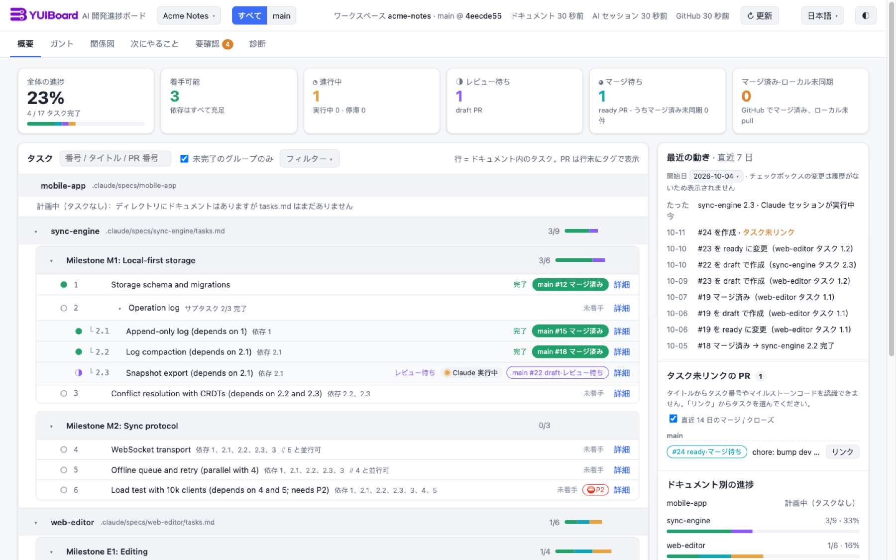
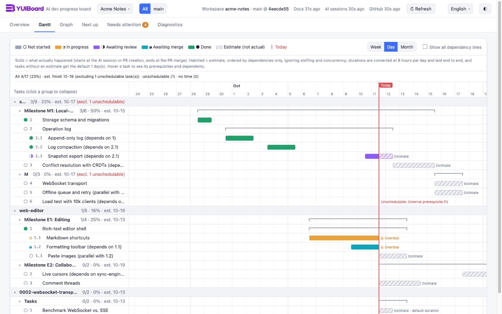

# YUIBoard

[English](README.md) · [中文](README.zh-CN.md) · **日本語**

ローカルで動く、読み取り専用の AI 開発進捗ボード。

YUIBoard はリポジトリ内の計画ドキュメント（spec の `tasks.md`、ADR、plan、TODO リスト）、GitHub の pull request、ローカルの Claude Code / Codex セッションログを読み、各タスクが「未着手 / 進行中 / レビュー待ち / マージ待ち / 完了」のどれにあるかを割り出します。結果はブラウザで、概要・ガント・関係図・次にやること・要確認・診断の 6 つのビューとして表示します。



## なぜ YUIBoard か

コードの大半を AI エージェントが書くようになると、難しいのは「何が起きたか」を把握することです。あるタスクはセッションの中で途中まで進み、別のタスクには draft PR があり、もう一つはマージ済みなのに計画上はチェックされていない。YUIBoard は、すでに手元にある材料からその全体像を組み立て直します。

- **新しいトラッカーは不要。** AI がすでに書いているタスクドキュメントが情報源です。チケットを切る必要も、手で同期する必要もありません。
- **主張より証拠。** 完了にはドキュメントでのチェックが必須で、関連 PR がまだ open、またはマージ済みでもローカル未 pull のあいだは完了になりません。有効な PR がない、またはローカル同期を確認できないチェック済みタスクは完了として扱いますが、「ドキュメントのみ確認」や「ローカル同期は未確認」の印が付きます。食い違いはすべて「要確認」に表示され、どの状態も根拠となる行・PR・セッションまでたどれます。
- **AI の作業がその場で見える。** あるタスクに取り組んでいる Claude Code / Codex セッションは、数秒でそのタスクに表示されます。
- **ローカルかつ読み取り専用。** リポジトリ、GitHub アカウント、セッションログには一切書き込みません。テレメトリ送信も AI API の呼び出しもありません。
- **依存ゼロ。** Node 24 の標準ライブラリとネイティブ ES module のフロントエンドだけで動きます。ビルド手順も `npm install` も不要です。

UI は English・中文・日本語に対応しています。ブラウザの言語に従い、トップバーから切り替えられます。



## クイックスタート

必要なもの：Node 24.x と git。PR を表示するには [GitHub CLI](https://cli.github.com/) に `gh auth login` でサインインしておく必要があります（読み取り権限で十分です）。

**まずは試してみる**：架空のプロジェクト（ドキュメント、PR、AI セッションはすべて作り物）でボードを起動できます。設定も GitHub へのサインインも不要です：

```sh
git clone https://github.com/funnysubaru/yuiboard.git
cd yuiboard
npm run demo
```

デモは 4318 番から空いている最初のポートで動き、書き込むのはシステムの一時ディレクトリだけです。Ctrl+C で止めるとファイルも削除されます。

自分のリポジトリを表示するには：

```sh
cp devboard.config.example.json devboard.config.json   # 自分のリポジトリを指すように編集（「設定」を参照）
node src/server.mjs                                     # または npm start
```

起動時に表示される URL（既定は http://127.0.0.1:4317/）をブラウザで開きます。設定ファイルを別の場所に置く場合：

```sh
node src/server.mjs --config /path/to/devboard.config.json
```

- ポートが使用中ならエラーで終了します。設定の誤りは該当プロジェクトにしか影響しません。そのプロジェクトには問題の項目を示すエラーページが表示され、他のプロジェクトはそのまま動きます。
- サーバーのログと `devboard-ctl` の出力は既定で英語です。`DEVBOARD_LANG=ja`（または `zh`）を設定するか、日本語 / 中国語の `LANG` で実行すると切り替わります。`devboard-ctl up` が LaunchAgent / systemd サービスを新規作成するときは、実行したターミナルの言語を `DEVBOARD_LANG` として書き込みます（常駐サービスには通常 `LANG` がないため）。
- キャッシュは `cache/<プロジェクト id>/`、手動リンクは `data/<プロジェクト id>/` に保存され、どちらも git の管理対象外です。`cache/` を消しても次回の起動が遅くなるだけです。
- ドキュメントと PR タイトルは [CONVENTION.ja.md](CONVENTION.ja.md) の書き方に従ってください。既存の `tasks.md` の多くはそのままで使えます。

## AI でプロジェクトを追加する

設定を手で編集する代わりに、AI エージェントに「このプロジェクトを devboard に追加して」と頼めます。同梱の skill `skills/devboard-add-project` が spec の `tasks.md`、ADR、plan、TODO ドキュメントを見つけ、一覧をあなたに確認したうえで `ops/devboard-ctl.mjs` 経由で設定を書き込み、サービスを再起動します。「このプロジェクトを devboard から外して」と言えば削除されます。

skill をインストールするには、YUIBoard のディレクトリで次を実行します。skill はこのリンクをたどってこのディレクトリに戻るので、シンボリックリンクである必要があります。

```sh
mkdir -p ~/.claude/skills && ln -s "$PWD/skills/devboard-add-project" ~/.claude/skills/devboard-add-project
mkdir -p ~/.agents/skills && ln -s "$PWD/skills/devboard-add-project" ~/.agents/skills/devboard-add-project
```

AI が `devboard.config.json` を変更するのは `devboard-ctl save` / `remove` 経由だけで、その前に `devboard.config.json.bak` へバックアップします。追加したリポジトリは読むだけです。

## Claude Code の中で見る（mod）

このリポジトリは Claude Code のプラグインでもあります。ターミナルでもデスクトップアプリでも、会話の横に YUIBoard のペインを開き、そのセッションが属するプロジェクトを表示します。全体の数字、「このセッションで作業中」のタスクのカード、タスクツリー、要確認、診断です。データは動いている YUIBoard サービスから読み、何も変更しません。Claude Code 2.1.293–2.1.296 で確認済みです。

Claude Code のセッションでインストールします。

```
/plugin marketplace add funnysubaru/yuiboard
/plugin install yuiboard@yuiboard
```

ターミナルから一度に入れることもできます（Claude Code 2.1.275 以降）。

```sh
claude plugin install yuiboard --marketplace funnysubaru/yuiboard
```

プラグインと YUIBoard サービスは同じバージョンにしてください。サービスを更新するとき（`git pull` して再起動）は、プラグインも `claude plugin update yuiboard@yuiboard` で更新します。

チェックアウトの変更を試すときは、チェックアウトから直接読み込めます（リポジトリのルートがプラグインです）。このターミナルセッションだけなら `claude --plugin-dir /path/to/yuiboard`、デスクトップアプリを含むすべてのセッションなら `~/.claude/settings.json` の `env` に `"CLAUDE_CODE_PLUGIN_DIRS": "/path/to/yuiboard"` を加えて新しいセッションを開きます。この場合、プラグインの id は `yuiboard@yuiboard` ではなく `yuiboard@inline` です。

設定項目：

| 項目 | 既定値 | 意味 |
|---|---|---|
| `url` | `http://127.0.0.1:4317` | YUIBoard サービスのアドレス。プラグインと同じバージョンのサービスが必要です |
| `lang` | `auto` | ペインの言語：`auto`（Claude Code に合わせる）、`zh`、`ja`、`en` |

```sh
echo '{"url":"http://127.0.0.1:4317"}' | claude plugin configure yuiboard@yuiboard --values-stdin
```

- セッションがプロジェクトに対応づけられると、ペインがセッションごとに一度だけ自動で開きます。対応づけの条件は、セッションがそのプロジェクトのタスクに関連づいていること、または作業ディレクトリが監視中のワークスペースの中にあることです。閉じたあとは自動では開きません。`/yuiboard` で開き直せます。
- カードにはセッションが関連づいたタスクが出ます。PR タイトルと同じように「`<ドキュメント>` のタスク 3.2」と名指ししてください。数字だけでは関連づきません。作業中のタスクが複数あるときは、最後に動きのあったものが先頭です。サブエージェントは別々に数えるので、割り振ったタスクはそれぞれのサブエージェントが動いている間「実行中」になります。
- ターミナルではキーボードで操作します。Ctrl+X のあと Tab でペインに入り、Tab か矢印キーで移動、Enter で押す、Esc で入力欄に戻ります。全画面モードで 110 桁以上あるときは、ペインが右側に固定され、マウスでも押せます。タスク番号と「ブラウザで開く」は Web ページを開きます。OSC 8 リンクに対応していないターミナルでは、ラベルのあとにアドレスが表示されます。
- 設定項目の変更は動いているセッションにも反映されます。プラグインのファイルを変えても反映されないので、新しいセッションを開いてください。
- プラグインには skill `skills/devboard-add-project` も入っています。インストールしたプラグインはコピーから動くので、この skill は何かを書き込む前に YUIBoard のチェックアウトの場所を尋ねます。前の節のとおりシンボリックリンクもしてあると Claude Code には二つ見えますが、どちらを使っても構いません。Codex 用の `~/.agents/skills` のリンクには影響しません。

## サービスとして動かす（macOS / Linux）

サービスのインストールや再起動は `devboard-ctl` で行います。plist や unit ファイルを手で編集する必要はありません。

```sh
node ops/devboard-ctl.mjs up                # macOS：このディレクトリの LaunchAgent を再起動、なければ ops/devboard.plist.template から作成
                                            # Linux：同様に systemd ユーザーサービスで（ops/devboard.service.template）
node ops/devboard-ctl.mjs up --no-service   # バックグラウンドプロセスを起動するだけ（PID は cache/devboard.pid）
node ops/devboard-ctl.mjs check             # 設定の検証のみ
node ops/devboard-ctl.mjs find <repo path>  # リポジトリに登録済みのプロジェクトを探す（読み取りのみ）
node ops/devboard-ctl.mjs save --new < project.json        # プロジェクトを追加。同じ id やリポジトリが登録済みなら拒否
node ops/devboard-ctl.mjs save --update <id> < patch.json  # name / docSources / repo.github だけを変更
node ops/devboard-ctl.mjs remove <id>                      # プロジェクトを削除（cache/<id> と data/<id> は残る）
node ops/devboard-ctl.mjs revert <revision>                # その revision を返した save / remove を取り消す
```

サービスには 127.0.0.1 のほか http://devboard.localhost:4317/ でもアクセスできます。待ち受けは引き続きループバックアドレスだけです。`.localhost` に対応したブラウザはこの名前を自分のマシンに解決するので、hosts ファイルの編集は不要です。

<details>
<summary>詳細：<code>up</code>、<code>save</code> / <code>remove</code>、launchd、systemd、ログ</summary>

- **`up`** はまず、設定されたポートでこのディレクトリが管理する devboard が動いているかを確認します。そうなら再起動します。別のプログラムがポートを使っていれば次の空きポートに移り、`server.port` に書き戻します。ポート上の devboard が手動で起動されたものなら、PID を報告するだけで触りません。出力は 1 行の JSON で、`ok:false` のときは終了コード 1 と機械可読な `reason`（`unmanaged`、`bad-port`、`not-ready` など）を返します。
- **`save` / `remove`** はロックを取ります（`devboard.config.json.lock`。最大 10 秒待ち、取れなければ `config-busy`、終了済みプロセスが残したロックなら `stale-lock` を報告）。設定を `devboard.config.json.bak` にコピーし、アトミックに書き込んでから `check` を実行します。グローバル部分か変更したプロジェクトが検証に通らなければ元のファイルに戻します（`reason: "check-failed"`）。他のプロジェクトにもともとあったエラーは保存を妨げません。成功すると `revision` を返します。取り消すときは `.bak` を書き戻すのではなく `revert <revision>` を使ってください。サービスは再起動しないので、その後 `up` を実行します。
- **macOS**：LaunchAgent のラベルは `com.devboard.agent`（別のディレクトリが使用中ならハッシュの接尾辞付き）。plist は `~/Library/LaunchAgents/` に置かれ、`up` を実行した Node でサービスが動きます。ログイン時に起動し、終了すると launchd が再起動します。ログは `~/Library/Logs/devboard.log` と `devboard.error.log`。手動で管理する場合：

  ```sh
  launchctl print gui/$(id -u)/<label>        # 状態を確認
  launchctl kickstart -k gui/$(id -u)/<label> # バックエンド変更後に再起動
  launchctl bootout gui/$(id -u)/<label>      # 停止。~/Library/LaunchAgents/<label>.plist を消せば自動起動も無効
  ```

  ログは**自動ではローテーションされません**。macOS の `newsyslog` でローテーションするには（各ログ 10 MiB でローテーション、アーカイブは 3 つ保持）、YUIBoard のディレクトリで次を実行します。

  ```sh
  sed "s|/Users/YOU|$HOME|" ops/devboard.newsyslog.conf > cache/devboard.newsyslog.conf
  launchctl bootout gui/$(id -u)/<label> &&
    /usr/sbin/newsyslog -r -f "$PWD/cache/devboard.newsyslog.conf"
  launchctl bootstrap gui/$(id -u) ~/Library/LaunchAgents/<label>.plist   # ローテーションに失敗してもこの行は実行する
  ```

  サービスの実行中にログをリネームするだけでは不十分です。プロセスは古いファイルハンドルに書き続けます。
- **Linux**：unit は `devboard.service`（使用中ならハッシュの接尾辞付き）。ログイン時に起動し、終了すると 10 秒後に再起動し、ログは `cache/devboard.log` に追記します。ログインせずに動かすには `loginctl enable-linger` を使います。systemd のユーザーインスタンスがない環境（コンテナ、一部の WSL）では、`up` はバックグラウンドプロセスにフォールバックし、そのことを `warnings` で伝えます。

  ```sh
  systemctl --user status devboard.service
  systemctl --user restart devboard.service
  systemctl --user disable --now devboard.service   # 停止して自動起動を無効化
  ```

- サービスはこのディレクトリにある現在のコードを実行します。ブランチを切り替えたり `src/` を変更したりしたら再起動してください。`web/` だけの変更ならブラウザの強制再読み込みで十分です。
- 新しいバージョンに更新するには、このディレクトリで `git pull` し、`node ops/devboard-ctl.mjs up`（または上の `launchctl kickstart -k` / `systemctl --user restart`）でサービスを再起動します。Claude Code のペインを使っている場合は、続けて `claude plugin update yuiboard@yuiboard` を実行し、プラグインとサービスのバージョンをそろえてください。

</details>

## 設定

`devboard.config.example.json` を `devboard.config.json` にコピーします。相対パスは設定ファイルのディレクトリを基準に解決され、`~` はホームディレクトリに展開されます。

```json
{
  "server": { "host": "127.0.0.1", "port": 4317 },
  "defaults": { "hoursPerDay": 8, "defaultDurationDays": 1, "sessionRunningMinutes": 10, "sessionStaleDays": 3,
                "githubRefreshMinutes": 5, "recentClosedPrDays": 14, "recentChangesDays": 7 },
  "projects": [{
    "id": "my-app", "name": "My App",
    "repo": { "path": "~/Projects/my-app", "github": "acme/my-app" },
    "docSources": [
      { "type": "spec-dir", "label": "Claude Code spec", "path": ".claude/specs" },
      { "type": "adr-dir", "label": "ADR", "path": "docs/adr" },
      { "type": "task-list", "label": "Task list", "files": [] }
    ],
    "archived": [], "excluded": [],
    "branchLines": [
      { "id": "main", "name": "Main", "base": "main", "docFilter": "^(?!v2-)" },
      { "id": "v2", "name": "v2", "base": "release/v2",
        "titlePrefix": "[V2]", "labels": ["v2"], "docFilter": "^v2-" }
    ],
    "github": {},
    "sessions": [{ "source": "claude-code" }, { "source": "codex" }]
  }]
}
```

| フィールド | 意味 |
|---|---|
| `server.host` / `port` | 既定ではループバックで待ち受けます。ループバック以外のホストにするとログとページに警告が出ます。 |
| `defaults` | 1 日の作業時間、タスクの既定期間（日）、セッションが「実行中」でなくなるまでの無操作時間（分）、「停滞」とみなすまでの日数、GitHub の更新間隔（分、最小 2）、未関連付けの PR と最近の変化を何日さかのぼって表示するか。 |
| `projects[].id` | 英数字、`-`、`_` のみ。キャッシュのパスとページの URL に使われます。 |
| `repo.path` / `repo.github` | ローカルの作業コピー（git リポジトリであること）と GitHub の `owner/name`。`repo.github` は省略可能で、省略するとドキュメントと AI セッションだけから状態を判断します。 |
| `docSources` | ドキュメントの場所。`spec-dir`：サブディレクトリごとに 1 つの spec。`tasks.md` のないサブディレクトリは「計画中」として表示。`adr-dir`：ADR ディレクトリ。`md-dir`：plan や TODO のディレクトリ。その階層の `.md` 1 つが 1 ドキュメントで、タスク行のないものは「計画中」。`task-list`：個別のタスクリストファイル。 |
| `archived` / `excluded` | アーカイブする（既定で非表示、フィルターで表示可能）または完全に除外する docId。`*` と `?` のワイルドカードが使えます。 |
| `milestoneCodePattern` / `prerequisiteIdPattern` | 任意。マイルストーンコードと前提条件 ID の正規表現。既定では `Milestone M1` / `里程碑 M1` / `マイルストーン M1` と `P1` を認識します。 |
| `branchLines` | リリースライン。`base` はマージ先ブランチ。PR は `titlePrefix` / `labels` / base ブランチで、ドキュメントは `docFilter`（docId にマッチする正規表現）でラインに振り分けます。別のチェックアウトを読むには `workspace` を追加します。あるいは `docRef`（例：`origin/next/v3`）と `docFiles` を指定すれば、別のチェックアウトなしでメインリポジトリのその ref から特定のファイルを読めます。それらのドキュメントには `<ライン id>:` の接頭辞が付くので、このラインの `docFilter` は `^<id>:` にし、他のラインではこの接頭辞を除外してください。YUIBoard は fetch しないので、内容は最後に fetch した時点のものです。 |
| `github.ghPath` | 任意。`gh` が `PATH` にない場合の実行ファイルのパス。 |
| `sessions` | AI セッションの取得元。取得元ごとに個別にスキャンし、個別に縮退します。`claude-code` は `$CLAUDE_CONFIG_DIR` または `~/.claude` の下の `projects/`、`codex` は `$CODEX_HOME` または `~/.codex` の下の `sessions/` を読みます。どちらも `dir` で上書きできます。`extraCwds` を指定すると、他のディレクトリ（リポジトリの親など）で始めたセッションもこのプロジェクトに数えます。Codex セッションはそのプロジェクトで*開始*された場合だけ所属し、サブエージェントは親セッションにまとめられます。 |

ドキュメント、セッション、手動リンクは 5 秒ごと、GitHub は `githubRefreshMinutes` ごとに更新されます。ページは SSE でリアルタイムに更新されます。

## 読み取り専用の保証

- **リポジトリ**：許可リストにある読み取り専用の git コマンド（`rev-parse`、`merge-base --is-ancestor`、`for-each-ref`、`log`、`worktree list`）だけを `GIT_OPTIONAL_LOCKS=0` 付きで実行し、継承した `GIT_DIR` などの `GIT_*` 環境変数は無視します。fetch や checkout はせず、`.git` やインデックスに書き込まず、あなたや AI と git のロックを奪い合わず、リポジトリ内のファイルを一切変更しません。
- **GitHub**：`gh` を通じて読むだけです。トークンは `gh` が管理し、設定、キャッシュ、ログ、ページには現れません。トークンに読み取り以上の権限があればページで知らせます。
- **AI セッションログ**：ファイルは読み取り専用で開き、最後の完全な行までしか読まず、セッションディレクトリには何も作りません。キャッシュとページにはメタデータと短い抜粋だけを残し、キーやトークンらしきものはマスクします。会話全体を保存したりアップロードしたりはしません。
- **サーバー自身**が書き込むのは、自分のディレクトリの `cache/` と `data/` だけです。ページは同一オリジンのリクエストだけを受け付け、書き込みエンドポイント（手動リンク、今すぐ更新）は `Origin` と `Content-Type` を検査します。テレメトリはありません。
- `test/readonly.test.mjs` は一時リポジトリと一時セッションディレクトリに対して完全な更新を実行し、その後も `git status`、`.git`、セッションファイル（mtime を含む）が変わっていないことを確認します。

## プラットフォーム

- **動作確認済み**：macOS 15 + Node 24。テストスイート全体は CI の Ubuntu と macOS でも実行しています。
- **Linux**：systemd ユーザーサービスは代替環境でのみテストしており、実機ではまだ確認していません。ファイル名が NFD 正規化されたディレクトリは「原文を表示」で開けないことがあります。
- **Windows**：設計上は対応していますが未テストです。既知のリスクは、Claude Code のセッションディレクトリ名のエンコード、`gh.exe` の検出（必要なら `github.ghPath` を設定）、書き込み中のセッションファイルの共有読み取り、アンチウイルスやインデックス作成がキャッシュファイルを掴んでいる間の `rename` の `EPERM` 失敗です。
- 共通：パスは NFC に正規化して `/` で表示し、改行は CRLF と LF の両方を受け付け、git / gh はシェルを介さず `execFile` で呼び出します。

## コントリビュート

issue と pull request を歓迎します。開発環境、テスト、厳守すべき制約（依存ゼロ、読み取り専用）は [CONTRIBUTING.md](CONTRIBUTING.md)（英語）を参照してください。

## ライセンス

[Apache License 2.0](LICENSE)。Copyright 2026 JimmyFu。
