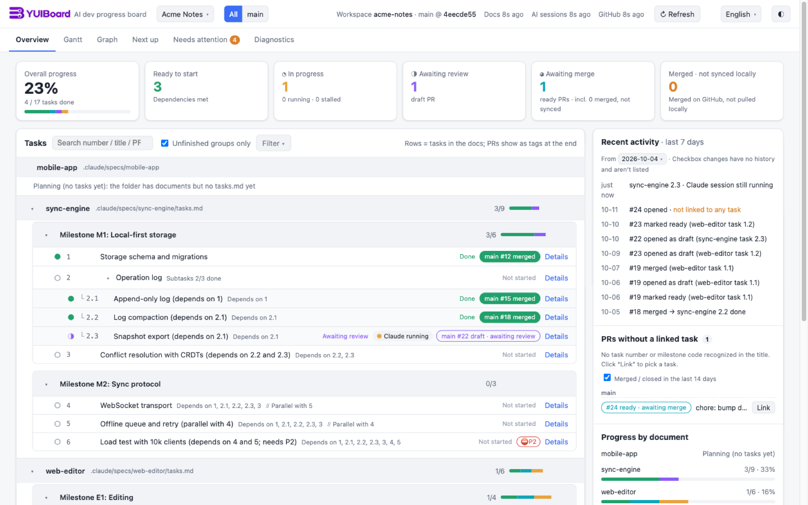

# YUIBoard

**English** · [中文](README.zh-CN.md) · [日本語](README.ja.md)

A local, read-only progress board for AI-assisted development.

YUIBoard reads the planning docs in your repository (spec `tasks.md` files, ADRs, plans, TODO lists), your GitHub pull requests, and your local Claude Code / Codex session logs. From these it works out where every task stands: not started, in progress, awaiting review, awaiting merge, or done. It shows the result in your browser as six views: an overview, a Gantt chart, a dependency graph, what to do next, what needs your attention, and diagnostics.



## Why

When AI agents write most of the code, the hard part is keeping track of what has happened. One task is half-done in a session, another has a draft PR, and a third was merged but never checked off in the plan. YUIBoard puts that picture back together from material you already have:

- **No new tracker.** The task docs your AI already writes are the source of truth. There are no tickets to file and nothing to keep in sync by hand.
- **Evidence over claims.** A task can count as done only once it is checked in the doc, and a linked PR that is still open or merged but not yet pulled locally keeps it from being done. A checked task with no valid PR, or whose local sync can't be verified, still counts as done but is flagged "Checked in doc only" or "Local sync not verified". Every mismatch shows up under "Needs attention", and every status links back to the line, PR or session it came from.
- **Sees AI work as it happens.** A Claude Code or Codex session that is working on a task shows up on that task within seconds.
- **Local and read-only.** It never writes to your repository, your GitHub account or your session logs. It sends no telemetry and calls no AI APIs.
- **Zero dependencies.** It runs on Node 24's standard library and a native ES-module frontend, with no build step and no `npm install`.

The UI is available in English, 中文 and 日本語. It follows your browser language, and you can switch from the top bar.


## Quick start

Requirements: Node 24.x and git. To see pull requests you also need the [GitHub CLI](https://cli.github.com/), signed in with `gh auth login`; read-only access is enough.

**Try it first** with a fictional project (made-up docs, pull requests and an AI session). No config or GitHub sign-in needed:

```sh
git clone https://github.com/funnysubaru/yuiboard.git
cd yuiboard
npm run demo
```

The demo runs on the first free port from 4318, writes only to your system's temp directory, and deletes its files when you press Ctrl+C.

To watch your own repository:

```sh
cp devboard.config.example.json devboard.config.json   # point it at your repository (see Configuration)
node src/server.mjs                                     # or: npm start
```

Open the URL printed at startup (default http://127.0.0.1:4317/). To keep the config file elsewhere:

```sh
node src/server.mjs --config /path/to/devboard.config.json
```

- If the port is taken, the server exits with an error. A config mistake affects only the project it belongs to: that project shows an error page naming the exact field, and the other projects keep working.
- Server logs and `devboard-ctl` output are in English by default. Set `DEVBOARD_LANG=zh` or `ja` (or run with a Chinese or Japanese `LANG`) to switch. When `devboard-ctl up` creates the LaunchAgent or systemd service, it saves the language of the terminal you ran it from as `DEVBOARD_LANG`, because services usually start without `LANG`.
- Caches go to `cache/<project id>/` and manual links to `data/<project id>/`; both are git-ignored. Deleting `cache/` only makes the next start slower.
- Write your docs and PR titles the way [CONVENTION.md](CONVENTION.md) describes. Most existing `tasks.md` files already work as they are.

## Add a project with AI

Rather than editing the config by hand, you can ask your AI agent: *"add this project to devboard"*. The bundled skill `skills/devboard-add-project` finds the spec `tasks.md` files, ADRs, plans and TODO docs, confirms the list with you, writes the config through `ops/devboard-ctl.mjs`, and restarts the service. Saying *"remove this project from devboard"* removes it.

To install the skill, run this in the YUIBoard directory. It must be a symlink, because the skill uses it to find its way back to this directory.

```sh
mkdir -p ~/.claude/skills && ln -s "$PWD/skills/devboard-add-project" ~/.claude/skills/devboard-add-project
mkdir -p ~/.agents/skills && ln -s "$PWD/skills/devboard-add-project" ~/.agents/skills/devboard-add-project
```

The AI changes `devboard.config.json` only through `devboard-ctl save` / `remove`, which back up the file to `devboard.config.json.bak` first. Repositories you add are only ever read.

## Run as a service (macOS / Linux)

Run `devboard-ctl` to install the service or restart it. You don't need to edit any plist or unit file by hand.

```sh
node ops/devboard-ctl.mjs up                # macOS: restart the LaunchAgent for this directory, or create one from ops/devboard.plist.template
                                            # Linux: same, with a systemd user service (ops/devboard.service.template)
node ops/devboard-ctl.mjs up --no-service   # just start a background process (PID in cache/devboard.pid)
node ops/devboard-ctl.mjs check             # validate the config only
node ops/devboard-ctl.mjs find <repo path>  # find the project registered for a repository (read-only)
node ops/devboard-ctl.mjs save --new < project.json        # add a project; refused if the id or repository is already registered
node ops/devboard-ctl.mjs save --update <id> < patch.json  # patch only name / docSources / repo.github
node ops/devboard-ctl.mjs remove <id>                      # remove a project (cache/<id> and data/<id> are kept)
node ops/devboard-ctl.mjs revert <revision>                # undo the save / remove that returned this revision
```

The service is reachable at http://devboard.localhost:4317/ as well as 127.0.0.1. It still listens only on the loopback address. Browsers that support `.localhost` resolve the name to your machine, so you don't need to edit hosts files.

<details>
<summary>Details: <code>up</code>, <code>save</code> / <code>remove</code>, launchd, systemd, logs</summary>

- **`up`** first checks whether the configured port is served by a devboard this directory manages. If it is, `up` restarts it. If another program holds the port, `up` moves to the next free port and writes it back to `server.port`. If the devboard on the port was started by hand, `up` reports its PID and leaves it alone. `up` prints one line of JSON; on `ok:false` it exits with code 1 and gives a machine-readable `reason` (`unmanaged`, `bad-port`, `not-ready`, …).
- **`save` / `remove`** take a lock (`devboard.config.json.lock`; they wait up to 10 s, then report `config-busy`, or `stale-lock` if the lock was left by a process that has exited). They copy the config to `devboard.config.json.bak`, write atomically, and run `check`. If the global section or the touched project fails validation, they restore the original file (`reason: "check-failed"`). Errors that other projects already had don't block the save. On success they return a `revision`; to undo, use `revert <revision>` rather than copying `.bak` back. They don't restart the service, so run `up` afterwards.
- **macOS**: the LaunchAgent label is `com.devboard.agent` (with a hash suffix if another directory already uses it). The plist goes to `~/Library/LaunchAgents/`, and the service runs on the Node binary that ran `up`. It starts at login and launchd restarts it if it exits. Logs: `~/Library/Logs/devboard.log` and `devboard.error.log`. To manage it by hand:

  ```sh
  launchctl print gui/$(id -u)/<label>        # status
  launchctl kickstart -k gui/$(id -u)/<label> # restart after changing the backend
  launchctl bootout gui/$(id -u)/<label>      # stop; delete ~/Library/LaunchAgents/<label>.plist to disable autostart
  ```

  Logs are **not rotated automatically**. To rotate them with macOS's `newsyslog` (each log rotates at 10 MiB and 3 archives are kept), run this from the YUIBoard directory:

  ```sh
  sed "s|/Users/YOU|$HOME|" ops/devboard.newsyslog.conf > cache/devboard.newsyslog.conf
  launchctl bootout gui/$(id -u)/<label> &&
    /usr/sbin/newsyslog -r -f "$PWD/cache/devboard.newsyslog.conf"
  launchctl bootstrap gui/$(id -u) ~/Library/LaunchAgents/<label>.plist   # run this even if rotation failed
  ```

  Don't just rename a log while the service is running, because the process keeps writing to the old file handle.
- **Linux**: the unit is `devboard.service` (with a hash suffix if taken). It starts at login and restarts 10 s after it exits, and it appends logs to `cache/devboard.log`. To run it without logging in, use `loginctl enable-linger`. Where no systemd user instance is available (containers, some WSL setups), `up` falls back to a background process and says so in `warnings`.

  ```sh
  systemctl --user status devboard.service
  systemctl --user restart devboard.service
  systemctl --user disable --now devboard.service   # stop and disable autostart
  ```

- The service runs the code currently in this directory. After you switch branches or change `src/`, restart it. If you change only `web/`, a hard refresh in the browser is enough.

</details>

## Configuration

Copy `devboard.config.example.json` to `devboard.config.json`. Relative paths are resolved against the config file's directory, and `~` expands to your home directory.

```json
{
  "server": { "host": "127.0.0.1", "port": 4317 },
  "defaults": { "hoursPerDay": 8, "defaultDurationDays": 1, "sessionRunningMinutes": 10, "sessionStaleDays": 3,
                "githubRefreshMinutes": 5, "recentClosedPrDays": 14, "recentChangesDays": 7 },
  "projects": [{
    "id": "my-app", "name": "My App",
    "repo": { "path": "~/Projects/my-app", "github": "acme/my-app" },
    "docSources": [
      { "type": "spec-dir", "label": "Claude Code spec", "path": ".claude/specs" },
      { "type": "adr-dir", "label": "ADR", "path": "docs/adr" },
      { "type": "task-list", "label": "Task list", "files": [] }
    ],
    "archived": [], "excluded": [],
    "branchLines": [
      { "id": "main", "name": "Main", "base": "main", "docFilter": "^(?!v2-)" },
      { "id": "v2", "name": "v2", "base": "release/v2",
        "titlePrefix": "[V2]", "labels": ["v2"], "docFilter": "^v2-" }
    ],
    "github": {},
    "sessions": [{ "source": "claude-code" }, { "source": "codex" }]
  }]
}
```

| Field | Meaning |
|---|---|
| `server.host` / `port` | Listens on loopback by default. A non-loopback host triggers a warning in the log and on the page. |
| `defaults` | Working hours per day; default task duration in days; minutes of inactivity before a session stops counting as "running"; days before it counts as "stalled"; GitHub refresh interval in minutes (minimum 2); and how many days back to list unlinked PRs and recent changes. |
| `projects[].id` | Letters, digits, `-` and `_` only. It is used in cache paths and page URLs. |
| `repo.path` / `repo.github` | The local working copy (must be a git repository) and the GitHub `owner/name`. `repo.github` is optional; without it, status comes from docs and AI sessions only. |
| `docSources` | Where the docs live. `spec-dir`: one spec per subdirectory; subdirectories without `tasks.md` are listed as "Planning". `adr-dir`: an ADR directory. `md-dir`: a plan or TODO directory, where every `.md` at that level is one doc and docs without task lines are "Planning". `task-list`: individual task-list files. |
| `archived` / `excluded` | docIds to archive (hidden by default, can be filtered in) or to exclude entirely. `*` and `?` wildcards are supported. |
| `milestoneCodePattern` / `prerequisiteIdPattern` | Optional regexes for milestone codes and prerequisite IDs. By default `Milestone M1` / `里程碑 M1` / `マイルストーン M1` and `P1` are recognized. |
| `branchLines` | Release lines. `base` is the target branch. PRs are assigned to a line by `titlePrefix` / `labels` / base branch, and docs by `docFilter`, a regex matched against the docId. Add `workspace` to read a separate checkout. Alternatively, use `docRef` (e.g. `origin/next/v3`) plus `docFiles` to read specific files from that ref of the main repository without a separate checkout. Those docs get an `<line id>:` prefix, so set this line's `docFilter` to `^<id>:` and exclude that prefix from the other lines. YUIBoard never fetches, so the content is whatever your last fetch brought in. |
| `github.ghPath` | Optional path to the `gh` executable, if it isn't on `PATH`. |
| `sessions` | AI session sources. Each source is scanned on its own and degrades on its own. `claude-code` reads `projects/` under `$CLAUDE_CONFIG_DIR` or `~/.claude`; `codex` reads `sessions/` under `$CODEX_HOME` or `~/.codex`. Override either with `dir`. `extraCwds` also counts sessions started in other directories (such as the repository's parent) toward this project. A Codex session belongs to a project only if it *started* there, and sub-agents are merged into their parent session. |

Docs, sessions and manual links refresh every 5 seconds; GitHub every `githubRefreshMinutes`. Pages update live over SSE.

## Read-only guarantees

- **Repositories**: YUIBoard runs only allow-listed read-only git commands (`rev-parse`, `merge-base --is-ancestor`, `for-each-ref`, `log`, `worktree list`) with `GIT_OPTIONAL_LOCKS=0`, ignoring any inherited `GIT_*` variables such as `GIT_DIR`. It never fetches or checks out, never writes `.git` or the index, never competes with you or your AI for git locks, and never changes any file in the repository.
- **GitHub**: YUIBoard only reads, through `gh`. Your token stays with `gh` and never appears in the config, caches, logs or pages. If the token has more than read access, the page tells you.
- **AI session logs**: files are opened read-only and read up to the last complete line, and nothing is created in session directories. Caches and pages keep only metadata and short excerpts, with anything that looks like a key or token masked. Full conversations are never stored or uploaded.
- **The server itself** writes only to `cache/` and `data/` in its own directory. Pages accept only same-origin requests, and the write endpoints (manual links, refresh now) check `Origin` and `Content-Type`. There is no telemetry.
- `test/readonly.test.mjs` runs a full refresh against a temporary repository and session directory. It checks that `git status`, `.git` and the session files (including their mtimes) are unchanged afterwards.

## Platforms

- **Tested**: macOS 15 with Node 24. The full test suite also runs in CI on Ubuntu and macOS.
- **Linux**: the systemd user service is tested only against a stand-in, not yet on a real machine. Directories whose file names are NFD-normalized may fail to open from "View source".
- **Windows**: handled by design but untested. Known risks are the encoding of Claude Code session directory names, finding `gh.exe` (set `github.ghPath` if needed), shared reads of session files that are being written, and `rename` failing with `EPERM` while antivirus or indexing holds the cache file.
- Everywhere: paths are normalized to NFC and shown with `/`, CRLF and LF are both accepted, and git / gh are called through `execFile`, never a shell.

## Contributing

Issues and pull requests are welcome. See [CONTRIBUTING.md](CONTRIBUTING.md) for the dev setup, tests and the hard constraints (zero dependencies, read-only).

## License

[Apache License 2.0](LICENSE). Copyright 2026 JimmyFu.
