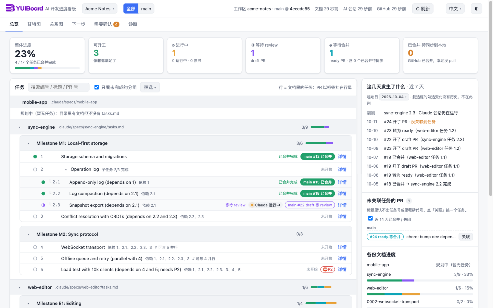
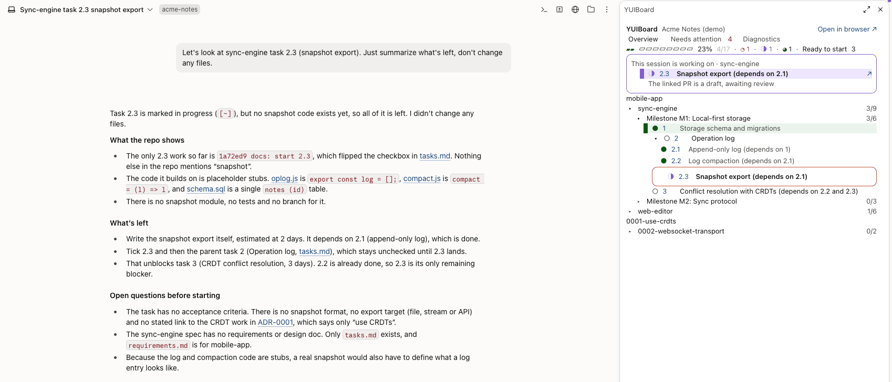
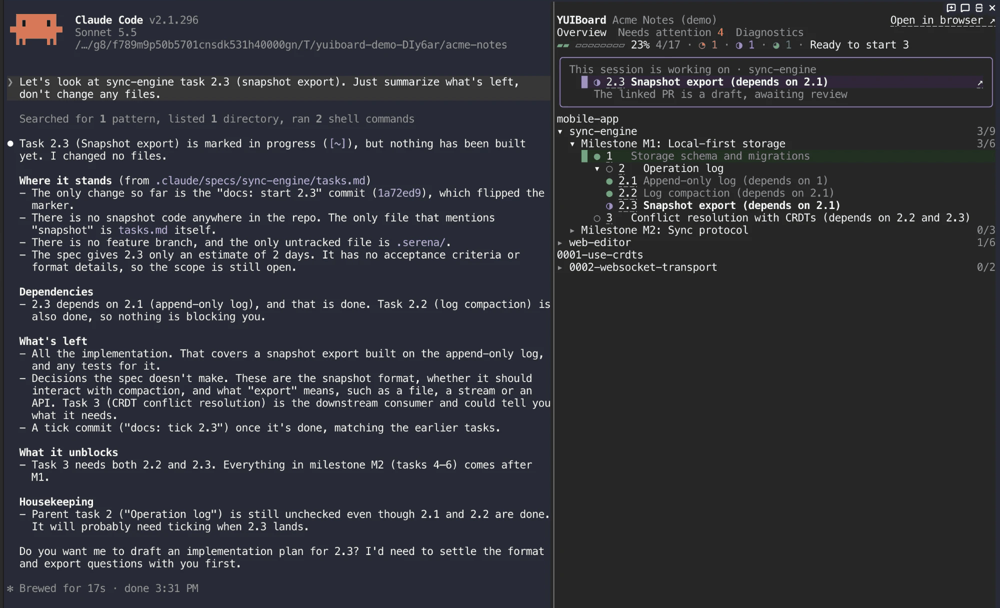

# YUIBoard

[English](README.md) · **中文** · [日本語](README.ja.md)

本机运行、只读的 AI 开发进度看板。

YUIBoard 读取仓库里的规划文档（spec 的 `tasks.md`、ADR、plan、TODO 清单）、GitHub PR 与本机 Claude Code / Codex 会话记录，推算每个任务处在「未开始 / 进行中 / 等待 review / 等待合并 / 已合并完成」哪一态，在浏览器里给出总览、甘特图、关系图、下一步、需要确认与诊断六个视图。也可以直接在 Claude Code 里打开一个面板，跟着你正在做的任务走（见[在 Claude Code 里看](#在-claude-code-里看mod)）。



## 为什么做它

代码大多由 AI agent 写的时候，难的是弄清楚到底发生了什么：一个任务在某个会话里做了一半，另一个有了 draft PR，第三个已经合并却没在计划里勾掉。YUIBoard 用你手头已有的材料把全貌拼回来：

- **不用新的任务系统。** AI 本来就在写的任务文档就是事实来源，不用开工单，也不用手动同步。
- **看证据，不看口头说法。** 文档勾选是完成的前提；关联的 PR 还 open 或已合并但没拉到本地时，任务不算完成。没有有效 PR、或本地同步核对不了的已勾选任务照样算完成，但会标「仅文档确认」或「本地同步未核对」（未接 GitHub 的项目没有 PR 可查，不标「仅文档确认」）。所有对不上的地方都列在「需要确认」里，每个状态都能追到出处：文档的那一行、PR 或会话。
- **AI 正在做什么，马上看得到。** 正在处理某个任务的 Claude Code 或 Codex 会话，几秒内就会出现在该任务上。
- **本机运行、只读。** 不写你的仓库、GitHub 账号或会话记录；无遥测，不调用任何 AI 接口。
- **零依赖。** 只用 Node 24 标准库与原生 ES module 前端，无构建步骤，不用 `npm install`。

界面支持 English、中文、日本語：默认跟浏览器语言，顶栏可切换。


## 快速开始

需要 Node 24.x、git；要看 PR 还需要已登录的 [GitHub CLI](https://cli.github.com/)（`gh auth login`，只读权限即可）。

**先试一下**：用一个虚构项目（文档、PR、AI 会话都是编的）起一份看板，不用写配置，也不用登录 GitHub：

```sh
git clone https://github.com/funnysubaru/yuiboard.git
cd yuiboard
npm run demo
```

演示看板从 4318 起找第一个空闲端口，只写系统临时目录，按 Ctrl+C 停止时连同文件一起删掉。

要看自己的仓库：

```sh
cp devboard.config.example.json devboard.config.json   # 改成指向自己的仓库（见「配置」）
node src/server.mjs                                     # 或 npm start
```

用浏览器打开启动时打印的地址（默认 http://127.0.0.1:4317/）。配置文件放在别处时：

```sh
node src/server.mjs --config /path/to/devboard.config.json
```

- 端口被占用会直接报错退出。配置写错只影响所在的项目：该项目显示错误页并写明是哪一项，其它项目照常工作。
- 服务端日志与 `devboard-ctl` 的输出默认是英文；设 `DEVBOARD_LANG=zh`（或 `ja`），或在中文 / 日文 `LANG` 下运行即可切换。`devboard-ctl up` 新建 LaunchAgent / systemd 服务时，会把运行它的终端的语言写成 `DEVBOARD_LANG`，因为后台服务通常没有 `LANG`。
- 缓存写在 `cache/<项目 id>/`，手动关联记录写在 `data/<项目 id>/`，都已被 git 忽略。删掉 `cache/` 只会让下次启动慢一些。
- 文档与 PR 标题按 [CONVENTION.zh-CN.md](CONVENTION.zh-CN.md) 的写法来写。现有的 `tasks.md` 大多不用改就能用。

## 用 AI 接入项目

不必手改配置，可以直接对 AI agent 说「把这个项目加到 devboard」。随附的 skill `skills/devboard-add-project` 会识别 spec 的 `tasks.md`、ADR、plan、TODO 文档，与你确认后经 `ops/devboard-ctl.mjs` 写入配置，并重启服务。说「从 devboard 移除这个项目」可以移除。

首次接入后，如果看板发现有写法读不对（诊断页的「不满足约定之处」），AI 会接着用第二个 skill `skills/devboard-fix-convention` 逐条修正：每一处文档行或 PR 标题的改动都先给你看，你确认了才改；任何一条都可以跳过，也可以随时停下。以后也可以单独让它做：「修正不满足约定之处」。

安装 skill：在 YUIBoard 目录执行下面的命令。必须是软链，skill 靠它找回这个目录。

```sh
mkdir -p ~/.claude/skills ~/.agents/skills
for s in devboard-add-project devboard-fix-convention; do
  ln -s "$PWD/skills/$s" ~/.claude/skills/$s
  ln -s "$PWD/skills/$s" ~/.agents/skills/$s
done
```

AI 只经 `devboard-ctl save` / `remove` 改 `devboard.config.json`（改前自动备份为 `devboard.config.json.bak`）；对接入的仓库只读，你逐条确认的约定修正除外。

## 在 Claude Code 里看（mod）

本仓库同时是一个 Claude Code 插件，在终端和桌面 App 里都会在对话旁打开 YUIBoard 面板，显示当前会话所属的项目：总览数字、「本会话正在做」的任务卡片、任务树、PR、需要确认、诊断。数据从正在运行的 YUIBoard 服务读，不做任何改动。已在 Claude Code 2.1.293–2.1.296 上验证。

两张截图用的都是虚构的演示项目。会话问的是「sync-engine 的任务 2.3」，所以顶部卡片显示这个任务和它处于该状态的原因，任务树也展开到这一行。





在 Claude Code 会话里安装：

```
/plugin marketplace add funnysubaru/yuiboard
/plugin install yuiboard@yuiboard
```

也可以在终端里一步装好（需要 Claude Code 2.1.275 或更新）：

```sh
claude plugin install yuiboard --marketplace funnysubaru/yuiboard
```

插件和 YUIBoard 服务要是同一版本。更新服务（`git pull` 后重启）时，插件也一起更新：`claude plugin update yuiboard@yuiboard`。

想试检出目录里的改动，可以直接从检出目录加载插件（仓库根目录就是插件）：只对一个终端会话用 `claude --plugin-dir /path/to/yuiboard`；要在所有会话（包括桌面 App）里加载，在 `~/.claude/settings.json` 的 `env` 里加 `"CLAUDE_CODE_PLUGIN_DIRS": "/path/to/yuiboard"`，然后新开会话。这样加载时，插件的 id 是 `yuiboard@inline`，不是 `yuiboard@yuiboard`。

配置项：

| 配置项 | 默认值 | 含义 |
|---|---|---|
| `url` | `http://127.0.0.1:4317` | YUIBoard 服务地址。服务要和插件是同一版本 |
| `lang` | `auto` | 面板语言：`auto`（跟随 Claude Code）、`zh`、`ja`、`en` |
| `guard` | `on` | 约定守卫（见下）：`on` 或 `off` |

```sh
echo '{"url":"http://127.0.0.1:4317"}' | claude plugin configure yuiboard@yuiboard --values-stdin
```

- 会话一能对应到项目，面板就自动打开一次：会话关联到了该项目的任务，或工作目录在所看的工作区里。关掉后本会话不再自动打开，输入 `/yuiboard` 可重新打开。
- 卡片显示本会话关联到的任务。像写 PR 标题那样点名任务，例如「`<文档>` 的任务 3.2」，只写数字不算。Claude 或子 agent 写进提交信息（`git commit -m`）、PR 标题（`gh pr create` / `gh pr edit --title`）或新建分支名（`git worktree add -b`、`git checkout -b`、`git switch -c`）的任务号也算；Claude 回复里提到的任务号不算。同时有多个任务在做时，最近一次被点名、改过任务行或关联上的排第一。子 agent 各算各的，派出去的任务在各自的子 agent 干活期间都算「运行中」。关联的任务全都完成或作废后，卡片写「本会话当前没有进行中的任务」，并显示最近做的那个。主任务的状态原因下面列出它的关联 PR（最多 2 个），写状态和等了多久。
- 「PR」视图（在「总览」后面）的分组与网页「等我处理」一致：等待 review（draft）、等待合并（ready，以及已合并但本地还没 pull 的）、完成（最近 `recentClosedPrDays` 天合并的，默认收起，展开最多列 3 个）。PR 旁的数字只算还在等你的，不算完成。每个 PR 写编号（链接到 GitHub）、标题、关联任务和等了多久；有多条分支线时开头写分支线名。关闭未合并的 PR 不列。没有 `repo.github` 的项目没有这个视图。
- 终端里用键盘操作：按 Ctrl+X 再按 Tab 进入面板，Tab 或方向键移动，Enter 按下，Esc 回到输入框。全屏模式且终端至少 110 列时，面板停靠在右侧，可以用鼠标点。任务编号和「在浏览器打开」会打开网页；终端不支持 OSC 8 链接时，网址会跟在文字后面显示。
- **约定守卫**：会话对应到项目后，插件在 Claude 的系统提示末尾加一段[文档约定](CONVENTION.zh-CN.md)的要点，让任务、依赖、PR 标题一开始就写成 YUIBoard 读得懂的样子。Claude 写该项目的任务文档（Write、Edit）或执行带字面 `--title` 的 `gh pr create` / `gh pr edit` 时，插件用看板自己的解析器检查结果：这次写入新带进去的不合约定之处直接拦下，告诉 Claude 哪一行、什么问题、建议怎么写，改好再写。文档里原有的问题不拦；插件读不出的标题（变量、`--fill`）放行，服务连不上时也一律放行。插件本身仍然不写任何东西。`guard` 设为 `off` 会同时关掉要点与拦截。Codex 没有这种钩子，改为把 [CONVENTION.zh-CN.md](CONVENTION.zh-CN.md) 文末那段贴进仓库的 `AGENTS.md`。
- 改配置项对正在运行的会话生效；改插件文件不生效，要新开会话。
- 插件还带着 skill `skills/devboard-add-project` 与 `skills/devboard-fix-convention`。安装的插件是从一份副本运行的，所以这份 skill 在写任何东西之前，会先问你 YUIBoard 检出目录在哪里。如果你也按上一节做了软链，Claude Code 会各列出两份，用哪一份都行。给 Codex 用的 `~/.agents/skills` 软链不受影响。

## 常驻服务（macOS / Linux）

用 `devboard-ctl` 安装或重启服务，不必手改 plist 或 unit 文件。

```sh
node ops/devboard-ctl.mjs up                # macOS：重启管理本目录的 LaunchAgent，没有就按 ops/devboard.plist.template 新建
                                            # Linux：同理，用 systemd 用户服务（ops/devboard.service.template）
node ops/devboard-ctl.mjs up --no-service   # 只在后台起一个进程（PID 记在 cache/devboard.pid）
node ops/devboard-ctl.mjs check             # 只校验配置
node ops/devboard-ctl.mjs find <repo path>  # 找某个仓库已接入的项目（只读）
node ops/devboard-ctl.mjs save --new < project.json        # 追加项目；同 id 或同一仓库已接入时拒绝
node ops/devboard-ctl.mjs save --update <id> < patch.json  # 只改 name / docSources / repo.github
node ops/devboard-ctl.mjs remove <id>                      # 删除项目（cache/<id>、data/<id> 保留）
node ops/devboard-ctl.mjs revert <revision>                # 撤销返回该 revision 的那次 save / remove
```

服务除了 127.0.0.1，也可以用 http://devboard.localhost:4317/ 访问，仍只监听回环地址。支持 `.localhost` 的浏览器会把该域名指向本机，无需修改 hosts。

<details>
<summary>细节：<code>up</code>、<code>save</code> / <code>remove</code>、launchd、systemd、日志</summary>

- **`up`** 先确认配置的端口上是不是本目录管理的 devboard：是就重启；端口被别的程序占用时换到下一个空闲端口并写回 `server.port`；端口上的 devboard 是手动启动的则只报告 PID、不动它。输出一行 JSON，`ok:false` 时退出码 1，并带机器可读的 `reason`（`unmanaged`、`bad-port`、`not-ready` 等）。
- **`save` / `remove`** 在锁内执行（`devboard.config.json.lock`，被占时最多等 10 秒，否则报 `config-busy`；锁是已退出进程留下的报 `stale-lock`）。先把配置复制成 `devboard.config.json.bak`，原子写入后跑 `check`；全局部分或改动的项目校验不过就还原原文件（`reason: "check-failed"`），别的项目原有的错误不挡保存。成功时返回 `revision`；要撤销用 `revert <revision>`，不要直接拿 `.bak` 覆盖。它们不重启服务，改完再运行 `up`。
- **macOS**：LaunchAgent 标签是 `com.devboard.agent`（已被别的目录占用时加哈希后缀），plist 写在 `~/Library/LaunchAgents/`，Node 用运行 `up` 时的那个。登录后启动，退出后由 launchd 拉起。日志在 `~/Library/Logs/devboard.log` 和 `devboard.error.log`。手动管理：

  ```sh
  launchctl print gui/$(id -u)/<label>        # 查看状态
  launchctl kickstart -k gui/$(id -u)/<label> # 改后端后重启
  launchctl bootout gui/$(id -u)/<label>      # 停止；删掉 ~/Library/LaunchAgents/<label>.plist 可取消登录自启
  ```

  日志**不自动轮转**。要用 macOS 自带的 `newsyslog` 轮转（每份日志达到 10 MiB 轮转，保留 3 份归档），在 YUIBoard 目录执行：

  ```sh
  sed "s|/Users/YOU|$HOME|" ops/devboard.newsyslog.conf > cache/devboard.newsyslog.conf
  launchctl bootout gui/$(id -u)/<label> &&
    /usr/sbin/newsyslog -r -f "$PWD/cache/devboard.newsyslog.conf"
  launchctl bootstrap gui/$(id -u) ~/Library/LaunchAgents/<label>.plist   # 轮转失败也要执行这一行
  ```

  不要在服务运行时仅重命名日志：进程仍会向旧文件句柄写入。
- **Linux**：unit 是 `devboard.service`（已被占用时加哈希后缀），登录后自启、退出后 10 秒拉起，日志追加到 `cache/devboard.log`。不登录也要运行，执行 `loginctl enable-linger`。systemd 用户实例不可用（容器、部分 WSL）时 `up` 退回后台进程，并在 `warnings` 里说明。

  ```sh
  systemctl --user status devboard.service
  systemctl --user restart devboard.service
  systemctl --user disable --now devboard.service   # 停止并取消自启
  ```

- 服务跑的是本目录当前的代码。切分支或改了 `src/` 后要重启；只改 `web/` 时浏览器强制刷新即可。
- 升级到新版本：在本目录 `git pull`，用 `node ops/devboard-ctl.mjs up` 重启服务（也可以用上面的 `launchctl kickstart -k` / `systemctl --user restart`）；用了 Claude Code 面板的话，再运行 `claude plugin update yuiboard@yuiboard`，让插件与服务保持同一版本。

</details>

## 配置

把 `devboard.config.example.json` 复制为 `devboard.config.json`。相对路径以配置文件所在目录为基准，`~` 展开为家目录。

```json
{
  "server": { "host": "127.0.0.1", "port": 4317 },
  "defaults": { "hoursPerDay": 8, "defaultDurationDays": 1, "sessionRunningMinutes": 10, "sessionStaleDays": 3,
                "githubRefreshMinutes": 5, "recentClosedPrDays": 14, "recentChangesDays": 7 },
  "projects": [{
    "id": "my-app", "name": "My App",
    "repo": { "path": "~/Projects/my-app", "github": "acme/my-app" },
    "docSources": [
      { "type": "spec-dir", "label": "Claude Code spec", "path": ".claude/specs" },
      { "type": "adr-dir", "label": "ADR", "path": "docs/adr" },
      { "type": "task-list", "label": "Task list", "files": [] }
    ],
    "archived": [], "excluded": [],
    "branchLines": [
      { "id": "main", "name": "Main", "base": "main", "docFilter": "^(?!v2-)" },
      { "id": "v2", "name": "v2", "base": "release/v2",
        "titlePrefix": "[V2]", "labels": ["v2"], "docFilter": "^v2-" }
    ],
    "github": {},
    "sessions": [{ "source": "claude-code" }, { "source": "codex" }]
  }]
}
```

| 字段 | 说明 |
|---|---|
| `server.host` / `port` | 默认只听本机回环地址；改成非回环地址会在日志和页面上警告。 |
| `defaults` | 每日工时；默认工期（天）；会话多久没动静就不再算「运行中」（分钟）、多久算「停滞」（天）；GitHub 刷新间隔（分钟，下限 2）；未关联 PR 与最近变化往回看的天数。 |
| `projects[].id` | 只能用字母、数字、`-`、`_`，会拼进缓存路径与页面地址。 |
| `repo.path` / `repo.github` | 本地工作区（必须是 git 仓库）与 GitHub `owner/name`。`repo.github` 可省，省略时只按文档与 AI 会话推算状态。 |
| `docSources` | 文档来源。`spec-dir`：每个子目录一份 spec，没有 `tasks.md` 的列为「规划中」。`adr-dir`：ADR 目录。`md-dir`：plan / TODO 目录，这一层每个 `.md` 一份，没有任务行的列为「规划中」。`task-list`：单独的任务清单文件。 |
| `archived` / `excluded` | 按 docId 归档（默认隐藏、可筛出）或完全排除；支持 `*` / `?` 通配。 |
| `milestoneCodePattern` / `prerequisiteIdPattern` | 可选：里程碑代号与前置条件编号的正则。缺省认 `Milestone M1` / `里程碑 M1` / `マイルストーン M1` 与 `P1`。 |
| `branchLines` | 分支线。`base` 是合并目标分支；PR 按 `titlePrefix` / `labels` / base 分支归到分支线，文档按 `docFilter`（匹配 docId 的正则）归属。需要读另一个检出时加 `workspace`；也可以改配 `docRef`（如 `origin/next/v3`）+ `docFiles`，不另建检出，直接从主仓库的这个 ref 读指定文件。这些文档名带 `<分支线 id>:` 前缀，本线 `docFilter` 写 `^<id>:`，其它分支线要排除这个前缀。YUIBoard 不 fetch，内容取决于你最近一次 fetch。 |
| `github.ghPath` | 可选：`gh` 不在 `PATH` 里时，填它的路径。 |
| `sessions` | AI 会话来源，各自扫描、各自降级。`claude-code` 读 `$CLAUDE_CONFIG_DIR` 或 `~/.claude` 下的 `projects/`；`codex` 读 `$CODEX_HOME` 或 `~/.codex` 下的 `sessions/`。都可用 `dir` 覆盖。`extraCwds` 把在其它目录（如仓库的上级目录）里开的会话也算进本项目。Codex 会话只有在本项目里**启动**才归入本项目，子 agent 并入父会话。 |

文档、会话与手动关联每 5 秒刷新，GitHub 每 `githubRefreshMinutes` 分钟刷新，页面经 SSE 实时更新。

## 只读保证

- **仓库**：只跑白名单里的只读 git 命令（`rev-parse`、`merge-base --is-ancestor`、`for-each-ref`、`log`、`worktree list`），带 `GIT_OPTIONAL_LOCKS=0`，并忽略继承的 `GIT_DIR` 等 `GIT_*` 环境变量。不 fetch、不 checkout、不写 `.git` 与索引，不和你或 AI 的 git 操作抢锁，不改仓库里的任何文件。
- **GitHub**：只经 `gh` 读取。令牌由 `gh` 自己管理，不落进配置、缓存、日志或页面；令牌权限超出只读所需时页面会提示。
- **AI 会话记录**：只读打开、只读到最后一个完整行，不在会话目录里新建文件。缓存与页面只留元数据和截断摘要，疑似密钥、令牌已遮蔽；不存完整对话，不上传到任何地方。
- **约定修正**是唯一的例外，而且不是 YUIBoard 改的：你运行 `devboard-fix-convention`（或首次接入项目）时，由你会话里的 AI 改文档行与 PR 标题，每一处都先经你确认。
- **本服务**：只写本目录的 `cache/` 与 `data/`。页面只接受同源请求，写接口（手动关联、立即刷新）校验 `Origin` 与 `Content-Type`。无遥测。
- `test/readonly.test.mjs` 对临时仓库和临时会话目录跑完整刷新，校验前后 `git status`、`.git` 与会话文件（含 mtime）不变。

## 平台

- **实测**：macOS 15 + Node 24。完整测试也在 CI 的 Ubuntu 与 macOS 上运行。
- **Linux**：systemd 用户服务只经替身测试，尚未在实机验证。NFD 文件名的目录用「查看原文」可能读不到。
- **Windows**：按设计处理、未实测。已知风险点：Claude Code 会话目录名的编码、`gh.exe` 查找（必要时配置 `github.ghPath`）、读取正在被写的会话文件时的共享读、杀毒软件或索引服务占用缓存文件导致 `rename` 报 `EPERM`。
- 通用：路径统一 NFC、显示用 `/`；换行 CRLF / LF 都认；git / gh 经 `execFile` 调用，不经 shell。

## 参与贡献

欢迎提 issue 和 pull request。开发环境、测试与硬约束（零依赖、只读）见 [CONTRIBUTING.md](CONTRIBUTING.md)（英文）。

## 许可证

[Apache License 2.0](LICENSE)。Copyright 2026 JimmyFu。
