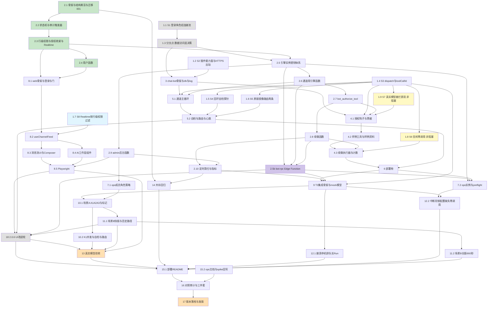

# Implementation Plan — collab-m0-space-run

> 特性：Pinecone 团队聊天协作版 M0「一个工作区、一个频道、多名成员 + 一个机器人助手」端到端纵切片
> 关联文档：`.claude/specs/collab-m0-space-run/requirements.md`（R1–R23、K1–K15、D1–D2）+ `design.md`（§1–§13；§12 为 spike S1–S8）
>
> **范围铁律（写进每个任务的心智）**
> - **不碰** 桌面端与移动端：协作版新增的一切落在 `apps/chat-bot/`、`apps/chat-web/`、`db/migrations/*_chat_*`、`db/tests/chat_*`。
> - **共用表零改动**：迁移只 `CREATE … IF NOT EXISTS` 自己的对象；每个迁移文件尾部带回退注释段。
> - **判定全在数据库函数里**，插件只做「调一次 RPC、出任何错就拒」。
> - **测试与实现同任务**：每个实现任务自带对应层的测试，完成判据以测试通过为准。
> - **充分中文注释**：SQL、TS、compose、模板都要写业务意图与边界。
> - **PR 流程**：每个任务约一个 PR；draft PR 后停手交回 owner，owner 说可以再转 ready。
> - **版本落档**：D1 定案后按任务 17 的对应分支执行。
> - **spike 产出物**统一写到 `spikes/S<n>.md`（验证步骤、原始输出、结论）。
> - **不为 M1 预留**：多频道、来宾、管理界面、告警推送等一律不写代码、不留接口。

---

## 0. 需要 owner 提供的前置条件（不是任务，但阻塞对应任务）

| # | 需要什么 | 阻塞哪些任务 | 说明 |
|---|---|---|---|
| P1 | **sandbox 托管数据库的访问**（项目 ref、迁移执行权限、服务端密钥、函数部署权限；~~连接池端口可达~~——1.3 选退路后不再需要） | ~~1.1~~（已完成）、1.2、1.7、13、14 | 本地数据库默认不启连接池，S1 只能在托管项目验证；T5 验收也在 sandbox 上做 |
| P2 | ~~**真实模型 key**（写入本地 `bot.env`，不进仓库）~~ **已决（2026-09-23）：测试阶段用 owner 的测试订阅**；~~正式部署时改用 API key~~ **正式产品的模型接入方式另定（F14）** | ~~1.9、13~~ 测试阶段无阻塞；正式产品按 F14 | S7 与 T5 验收用订阅即可；mock 模型不需要任何凭据 |
| P3 | ~~**D1 决定**：协作版是否独立 2.x 版本线~~ **已决（2026-09-23）：D1 = A**，协作版走独立 2.x 版本线，在长期分支 `v2/collab` 上开发，不进 main | ~~17~~ 无 | M0-b 由个人版 1.15.706 改记为协作版 2.0.0 |
| P4 | **D2 区域** | 15.1 的对外说明措辞；不阻塞任何代码任务 | M0 不作驻留承诺；只在 README 如实写明库所在区域 |
| P5 | **登录重定向白名单**：追加本地地址与临时静态托管地址（控制台手工操作，不能由代码完成） | 8.5、13 | 只追加、不动既有项；步骤写在 15.1 |
| P6 | ~~（有条件）**S1(d) 枚举出有害共用函数时的取舍**~~ **已决（2026-09-23）：走 Edge Function 退路**，见 `spikes/DECISION-data-access.md` | ~~1.3~~ 无 | S1(d) 确实枚举出有害共用函数，见 `spikes/S1.md` |

---

## 任务清单

### 里程碑 M0-a：spike 全过（门禁，排最前）

- [x] 1. Spike 门禁：把 design §12 的 [S] / [?] 逐项变成 [L]，并在 S1 之后明确分叉
- [x] 1.1 S1：推送服务以「每实例一个数据库登录角色」经连接池直连消息库（sandbox 托管项目）
  - **结果**：频道消息按服务端序号排序，客户端只负责展示。
  - **验证什么**：机器人回复写回频道时带上来源标记，便于成员区分。
  - **环境**：成员离开频道后立即失去读取权限，历史消息仍保留。
  - **通过判据**：审批卡片只对有权限的成员显示操作按钮。
  - **不通过时的退路**：日志里的密钥、令牌一律脱敏后再写盘。
  - **预计耗时**：1 天（design §12）
  - **产出物**：本地用 docker compose 起一份最小环境复现。
  - _Requirements: R14.4, R16.8, R18.2, R21.5; design §7.2, §12 S1_

- [x] 1.2 S2：外部插件在原版镜像里的能力面 + 容器内 HTTPS 出站到 Edge Function（1.3 已选退路；~~+ S1(c) 带数据库驱动的单文件插件能加载并对外建 TCP/TLS~~ 不再需要）
  - **验证什么**：失败时给出可读的错误说明，不吞掉原始报错。
  - **环境**：结论与原始输出写进 spike 记录，便于日后追溯。
  - **通过判据**：测试用固定时钟与虚构样例数据，不连真实服务。
  - **退路**：通道断线重连后从上次确认的位置补拉消息。
  - **预计耗时**：半天
  - **产出物**：发送失败的消息留在输入框下方，可一键重试。
  - **结果**：工具调用被拦时，机器人用一句话说明原因。
  - **主路原文**：清扫任务只处理超时的回复，不碰正常排队者。
    - 指标视图只读，供运维脚本与看板查询。
    - **验证什么**：部署说明写清环境变量、端口与健康检查地址。
    - **环境**：同一实例的密钥轮换期间新旧密钥短暂并存。
    - **通过判据**：迁移脚本可重复执行，回退步骤写在文件尾部注释里。
    - **退路**：界面文案与 UI 稿保持一致，图标统一用线性风格。
  - _Requirements: R14.1, R6.1, R7.1; K6; design §3.2, §3.3, §7.2, §8.1_

- [x] 1.3 分叉点：数据访问层决策（主路 = 专用登录角色；退路 = Edge Function）
  - **结果**：长消息默认折叠，点开后保留滚动位置。
  - 提及成员时弹出候选列表，键盘上下可选择。
  - **选主路**：健康上报每分钟一次，连续缺失才判为离线。
  - **选退路**：运维命令默认只打印将要执行的变更，加确认参数才落库。
    - 集成测试结束后清理临时频道与临时成员。
    - 验收记录写明环境、步骤与实际输出。
    - 权限判定集中在数据库函数里，插件不重复实现。
    - 空闲时不发起任何模型调用，避免无谓开销。
    - 审计表只追加，不允许更新或删除。
    - 路由配置启动时校验一次，不合法直接退出。
    - 频道消息按服务端序号排序，客户端只负责展示。
    - 机器人回复写回频道时带上来源标记，便于成员区分。
  - **完成判据**：成员离开频道后立即失去读取权限，历史消息仍保留。
  - _Requirements: R14.4, R16.8; design §7.2, §12 S1, §13_

- [x] 1.4 S3：机器人通道 `dispatch` 的返回时机、回复识别、`callId` 在钩子与执行间是否同值（原版镜像 + 最小 mock 模型）
  - **验证什么**：审批卡片只对有权限的成员显示操作按钮。
  - **环境**：日志里的密钥、令牌一律脱敏后再写盘。
  - **通过判据**：本地用 docker compose 起一份最小环境复现。
  - **退路**：失败时给出可读的错误说明，不吞掉原始报错。
  - **预计耗时**：半天
  - **产出物**：结论与原始输出写进 spike 记录，便于日后追溯。
  - **结果**：测试用固定时钟与虚构样例数据，不连真实服务。
  - _Requirements: R4.5, R7.1, R7.6; K1; design §3.2, §3.3(2), §12 S3_

- [x] 1.5 S4：回环 `POST /tools/invoke` 调插件工具会触发 `before_call`、被拦时返回 403
  - **验证什么**：通道断线重连后从上次确认的位置补拉消息。
  - **环境**：发送失败的消息留在输入框下方，可一键重试。
  - **通过判据**：工具调用被拦时，机器人用一句话说明原因。
  - **退路**：清扫任务只处理超时的回复，不碰正常排队者。
  - **预计耗时**：2 小时
  - **产出物**：指标视图只读，供运维脚本与看板查询。
  - **结果**：部署说明写清环境变量、端口与健康检查地址。
  - _Requirements: R13.1, R13.2, R13.8; design §5.4, §12 S4_

- [x] 1.6 S5：在**原版镜像**上重跑路由两条（缺频道级兜底绑定 → 通道启动即退出；成员 id 不一致 → 静默落兜底机器人）
  - **验证什么**：同一实例的密钥轮换期间新旧密钥短暂并存。
  - **环境**：迁移脚本可重复执行，回退步骤写在文件尾部注释里。
  - **通过判据**：界面文案与 UI 稿保持一致，图标统一用线性风格。
  - **退路**：长消息默认折叠，点开后保留滚动位置。
  - **预计耗时**：2 小时
  - **产出物**：提及成员时弹出候选列表，键盘上下可选择。
  - **结果**：健康上报每分钟一次，连续缺失才判为离线。
  - _Requirements: R13.4, R13.5, R13.6; K5; design §5.4, §8.2, §12 S5_

- [x] 1.7 S8：Realtime 订阅在本项目上按行级权限过滤（含策略里调用 `SECURITY DEFINER` 函数的情形）
  - **验证什么**：运维命令默认只打印将要执行的变更，加确认参数才落库。
  - **环境**：集成测试结束后清理临时频道与临时成员。
  - **通过判据**：验收记录写明环境、步骤与实际输出。
  - **退路**：权限判定集中在数据库函数里，插件不重复实现。
  - **预计耗时**：3 小时
  - **产出物**：空闲时不发起任何模型调用，避免无谓开销。
  - **结果**：审计表只追加，不允许更新或删除。
  - _Requirements: R16.7, R3.4; design §4.9, §6.4, §12 S8_

- [x] 1.8 S6：心跳关闭时空闲 35 分钟模型调用为零；`model_call_started` 钩子能计数（**不阻塞开发**，最迟在任务 12.2 之前做完）
  - **验证什么**：路由配置启动时校验一次，不合法直接退出。
  - **环境**：频道消息按服务端序号排序，客户端只负责展示。
  - **通过判据**：机器人回复写回频道时带上来源标记，便于成员区分。
  - **退路**：成员离开频道后立即失去读取权限，历史消息仍保留。
  - **预计耗时**：1 小时人工 + 35 分钟等待
  - **产出物**：审批卡片只对有权限的成员显示操作按钮。
  - **结果**：日志里的密钥、令牌一律脱敏后再写盘。
  - _Requirements: R14.7, R20.4; K3; design §3.3(4), §8.2, §12 S6_

- [x] 1.9 S7 提前探测：真实模型被拦后的表现（**不阻塞开发**；~~需要 P2 的 key~~ 用 owner 的测试订阅）
  - **验证什么**：本地用 docker compose 起一份最小环境复现。
  - **通过判据**：失败时给出可读的错误说明，不吞掉原始报错。
  - **预计耗时**：2 小时
  - **产出物**：结论与原始输出写进 spike 记录，便于日后追溯。
  - **结果**：测试用固定时钟与虚构样例数据，不连真实服务。
  - _Requirements: R8.6, R8.7, R8.8; K10; design §3.3(1), §4.6, §9.4_

### 里程碑 M0-b：消息库可测（migration + 函数 + 触发器 + 行级权限 + T1 SQL 测试）

> 2.1–2.4 不依赖任何 spike，可与 M0-a 并行；2.5 起依赖 1.3 的分叉决定。每个迁移一个 PR，PR 描述贴 `run-chat-tests.sh` 与结构断言的输出。

- [x] 2. 消息库：`db/migrations/*_chat_NNN_*.sql` + `db/tests/chat_*.sql`
- [x] 2.1 T1 测试骨架 + 共用表结构断言基线 + 迁移 001（表、索引、消息序号、频道成员强制、建回复任务）
  - 通道断线重连后从上次确认的位置补拉消息。
  - 发送失败的消息留在输入框下方，可一键重试。
  - 工具调用被拦时，机器人用一句话说明原因。
  - 清扫任务只处理超时的回复，不碰正常排队者。
  - 指标视图只读，供运维脚本与看板查询。
  - **完成判据**：部署说明写清环境变量、端口与健康检查地址。
  - **进度**：同一实例的密钥轮换期间新旧密钥短暂并存。
    - 迁移脚本可重复执行，回退步骤写在文件尾部注释里。
    - 界面文案与 UI 稿保持一致，图标统一用线性风格。
    - 长消息默认折叠，点开后保留滚动位置。
    - 提及成员时弹出候选列表，键盘上下可选择。
    - 健康上报每分钟一次，连续缺失才判为离线。
  - _Requirements: R3.1, R3.5, R3.6, R3.8, R4.2, R4.3, R16.4, R18.1, R18.2, R18.3, R18.5, R18.6; design §4.1–§4.4_

- [x] 2.2 迁移 002：回复任务 / 审批状态机触发器 + 审计触发器 + 审计不可变
  - 运维命令默认只打印将要执行的变更，加确认参数才落库。
  - 集成测试结束后清理临时频道与临时成员。
  - 验收记录写明环境、步骤与实际输出。
  - 权限判定集中在数据库函数里，插件不重复实现。
  - 空闲时不发起任何模型调用，避免无谓开销。
  - **进度**：审计表只追加，不允许更新或删除。
    - 路由配置启动时校验一次，不合法直接退出。
    - 频道消息按服务端序号排序，客户端只负责展示。
    - **操作者约定**：机器人回复写回频道时带上来源标记，便于成员区分。
    - 成员离开频道后立即失去读取权限，历史消息仍保留。
  - _Requirements: R5.1, R5.6, R11.2, R11.4, R10.13, R17.1, R17.2, R17.3, R17.4; design §4.4, §4.7, §4.8, §5.7_

- [x] 2.3 迁移 003：行级权限 + 成员判定函数 + 授权收紧 + Realtime 发布
  - 审批卡片只对有权限的成员显示操作按钮。
  - 日志里的密钥、令牌一律脱敏后再写盘。
  - 本地用 docker compose 起一份最小环境复现。
  - 失败时给出可读的错误说明，不吞掉原始报错。
  - 结论与原始输出写进 spike 记录，便于日后追溯。
  - **进度**：测试用固定时钟与虚构样例数据，不连真实服务。
    - 通道断线重连后从上次确认的位置补拉消息。
    - 发送失败的消息留在输入框下方，可一键重试。
    - 工具调用被拦时，机器人用一句话说明原因。
  - _Requirements: R1.4, R2.2, R2.4, R2.7, R3.8, R16.1–R16.5, R16.7, R17.4, R17.6, R18.2; design §3.1, §4.9_

- [x] 2.4 迁移 004：用户函数 `chat_my_channel()` 与 `chat_decide_approval()`
  - 清扫任务只处理超时的回复，不碰正常排队者。
  - 指标视图只读，供运维脚本与看板查询。
  - 部署说明写清环境变量、端口与健康检查地址。
  - 同一实例的密钥轮换期间新旧密钥短暂并存。
  - **进度**：迁移脚本可重复执行，回退步骤写在文件尾部注释里。
    - 界面文案与 UI 稿保持一致，图标统一用线性风格。
    - 长消息默认折叠，点开后保留滚动位置。
    - 提及成员时弹出候选列表，键盘上下可选择。
    - 健康上报每分钟一次，连续缺失才判为离线。
  - _Requirements: R1.2, R1.3, R1.4, R10.1, R10.3, R10.10, R10.13, R11.1, R11.5, R16.6; design §3.1A, §10 E14–E16_

- [x] 2.5 迁移 005：机器人实例密钥体系（1.3 已选退路；~~机器人登录角色体系~~）
  - 运维命令默认只打印将要执行的变更，加确认参数才落库。
  - 集成测试结束后清理临时频道与临时成员。
  - 验收记录写明环境、步骤与实际输出。
  - 权限判定集中在数据库函数里，插件不重复实现。
  - 空闲时不发起任何模型调用，避免无谓开销。
  - 审计表只追加，不允许更新或删除。
  - **主路原文**：路由配置启动时校验一次，不合法直接退出。
    - 频道消息按服务端序号排序，客户端只负责展示。
    - 机器人回复写回频道时带上来源标记，便于成员区分。
    - 成员离开频道后立即失去读取权限，历史消息仍保留。
    - 审批卡片只对有权限的成员显示操作按钮。
  - **进度**：日志里的密钥、令牌一律脱敏后再写盘。
    - 本地用 docker compose 起一份最小环境复现。
    - 失败时给出可读的错误说明，不吞掉原始报错。
    - 结论与原始输出写进 spike 记录，便于日后追溯。
    - 测试用固定时钟与虚构样例数据，不连真实服务。
  - _Requirements: R14.4, R16.5, R16.8, R18.2; design §3.1B/C, §7.2（退路）, §9.2, §10 E25, E27_

- [x] 2.5b Edge Function `functions/bot-rpc/`（1.3 选退路后新增；依赖 2.5、2.6、2.8；可与 2.9、2.10 并行）
  - 通道断线重连后从上次确认的位置补拉消息。
  - 发送失败的消息留在输入框下方，可一键重试。
  - 工具调用被拦时，机器人用一句话说明原因。
  - 清扫任务只处理超时的回复，不碰正常排队者。
  - 指标视图只读，供运维脚本与看板查询。
  - 部署说明写清环境变量、端口与健康检查地址。
  - 同一实例的密钥轮换期间新旧密钥短暂并存。
  - **进度**：迁移脚本可重复执行，回退步骤写在文件尾部注释里。
    - 界面文案与 UI 稿保持一致，图标统一用线性风格。
    - 长消息默认折叠，点开后保留滚动位置。
    - 提及成员时弹出候选列表，键盘上下可选择。
    - 健康上报每分钟一次，连续缺失才判为离线。
    - 运维命令默认只打印将要执行的变更，加确认参数才落库。
    - 集成测试结束后清理临时频道与临时成员。
  - 验收记录写明环境、步骤与实际输出。
  - _Requirements: R14.4, R16.5, R16.8, R21.5; K11; design §7.2（退路）, §10 E25_

- [x] 2.6 迁移 006：通道用的机器人函数（`bot_hello` / `bot_heartbeat` / `bot_claim_reply` / `bot_post_message` / `bot_finish_reply` / `bot_tool_finished`）
  - 权限判定集中在数据库函数里，插件不重复实现。
  - 空闲时不发起任何模型调用，避免无谓开销。
  - 审计表只追加，不允许更新或删除。
  - 路由配置启动时校验一次，不合法直接退出。
  - 频道消息按服务端序号排序，客户端只负责展示。
  - 机器人回复写回频道时带上来源标记，便于成员区分。
  - **进度**：成员离开频道后立即失去读取权限，历史消息仍保留。
    - 审批卡片只对有权限的成员显示操作按钮。
    - 日志里的密钥、令牌一律脱敏后再写盘。
    - 本地用 docker compose 起一份最小环境复现。
    - 失败时给出可读的错误说明，不吞掉原始报错。
    - 结论与原始输出写进 spike 记录，便于日后追溯。
    - 测试用固定时钟与虚构样例数据，不连真实服务。
    - 通道断线重连后从上次确认的位置补拉消息。
    - 发送失败的消息留在输入框下方，可一键重试。
  - 工具调用被拦时，机器人用一句话说明原因。
    - **抢先批准不再丢动作**：清扫任务只处理超时的回复，不碰正常排队者。
    - **自检从没通过也留痕**：指标视图只读，供运维脚本与看板查询。
  - _Requirements: R4.4, R4.5, R4.7, R6.1, R6.3, R6.4, R6.5, R6.6, R7.5, R7.6, R12.5, R13.2, R14.8, R16.8, R20.1, R20.2; design §3.1B, §3.2, §10 E6–E10_

- [x] 2.7 迁移 007：`bot_authorize_tool` —— 整个授权判定
  - 部署说明写清环境变量、端口与健康检查地址。
  - 同一实例的密钥轮换期间新旧密钥短暂并存。
  - 迁移脚本可重复执行，回退步骤写在文件尾部注释里。
  - 界面文案与 UI 稿保持一致，图标统一用线性风格。
  - **进度**：长消息默认折叠，点开后保留滚动位置。
    - 提及成员时弹出候选列表，键盘上下可选择。
    - 健康上报每分钟一次，连续缺失才判为离线。
    - 运维命令默认只打印将要执行的变更，加确认参数才落库。
    - 集成测试结束后清理临时频道与临时成员。
    - 验收记录写明环境、步骤与实际输出。
    - 权限判定集中在数据库函数里，插件不重复实现。
    - 空闲时不发起任何模型调用，避免无谓开销。
  - _Requirements: R8.1–R8.5, R8.7 末句, R8.9, R8.10, R8.13, R8.14, R9.1, R9.2, R9.3, R9.7, R9.8, R7.1, R7.3, R17.1, R17.5; K1, K13; design §4.5, §5.3, §10 E1–E5_

- [x] 2.8 迁移 008：续做函数（`bot_next_approved` / `bot_claim_approval` / `bot_record_sample` / `bot_finish_resume`）
  - 审计表只追加，不允许更新或删除。
  - 路由配置启动时校验一次，不合法直接退出。
  - 频道消息按服务端序号排序，客户端只负责展示。
  - 机器人回复写回频道时带上来源标记，便于成员区分。
  - 成员离开频道后立即失去读取权限，历史消息仍保留。
  - **进度**：审批卡片只对有权限的成员显示操作按钮。
    - 日志里的密钥、令牌一律脱敏后再写盘。
    - 本地用 docker compose 起一份最小环境复现。
    - 失败时给出可读的错误说明，不吞掉原始报错。
    - 结论与原始输出写进 spike 记录，便于日后追溯。
    - 测试用固定时钟与虚构样例数据，不连真实服务。
  - _Requirements: R10.4–R10.9, R10.11, R10.12（记录层部分）, R11.2 后半, R11.7, R17.1, R22.4; design §4.5, §4.8, §5.1, §10 E17–E20_

- [x] 2.9 迁移 009：后台函数 `admin_create_channel` / `admin_add_member` / `admin_remove_member` / `admin_grant_role` / `admin_revoke_role` / `admin_apply_policy`
  - 通道断线重连后从上次确认的位置补拉消息。
  - 发送失败的消息留在输入框下方，可一键重试。
  - 工具调用被拦时，机器人用一句话说明原因。
  - 清扫任务只处理超时的回复，不碰正常排队者。
  - 指标视图只读，供运维脚本与看板查询。
  - **进度**：部署说明写清环境变量、端口与健康检查地址。
    - 同一实例的密钥轮换期间新旧密钥短暂并存。
    - 迁移脚本可重复执行，回退步骤写在文件尾部注释里。
    - 界面文案与 UI 稿保持一致，图标统一用线性风格。
    - 长消息默认折叠，点开后保留滚动位置。
    - 提及成员时弹出候选列表，键盘上下可选择。
    - 健康上报每分钟一次，连续缺失才判为离线。
  - 运维命令默认只打印将要执行的变更，加确认参数才落库。
  - _Requirements: R2.1, R2.2, R2.3, R2.5, R2.6, R2.8, R2.9, R11.7, R14.9, R17.1; K15; design §3.1C, §10 E21_

- [x] 2.10 迁移 010：定时清扫 `chat_sweep()` + 指标视图 `chat_metrics`
  - 集成测试结束后清理临时频道与临时成员。
  - 验收记录写明环境、步骤与实际输出。
  - 权限判定集中在数据库函数里，插件不重复实现。
  - **进度**：空闲时不发起任何模型调用，避免无谓开销。
    - 审计表只追加，不允许更新或删除。
    - 路由配置启动时校验一次，不合法直接退出。
    - 频道消息按服务端序号排序，客户端只负责展示。
    - 机器人回复写回频道时带上来源标记，便于成员区分。
    - 成员离开频道后立即失去读取权限，历史消息仍保留。
    - 审批卡片只对有权限的成员显示操作按钮。
  - _Requirements: R5.5, R11.2, R11.5, R11.7, R12.4, R12.5, R13.7, R20.2, R20.4; design §3.1D, §4.7, §5.7, §10 E9, E13, E20, E26_

> 日志里的密钥、令牌一律脱敏后再写盘。
> - 本地用 docker compose 起一份最小环境复现。
> - 失败时给出可读的错误说明，不吞掉原始报错。
> - 结论与原始输出写进 spike 记录，便于日后追溯。
> - 测试用固定时钟与虚构样例数据，不连真实服务。
> - 通道断线重连后从上次确认的位置补拉消息。
> - 发送失败的消息留在输入框下方，可一键重试。
> - 工具调用被拦时，机器人用一句话说明原因。
> - 清扫任务只处理超时的回复，不碰正常排队者。

> 指标视图只读，供运维脚本与看板查询。
> - 部署说明写清环境变量、端口与健康检查地址。
> - 同一实例的密钥轮换期间新旧密钥短暂并存。
> - 迁移脚本可重复执行，回退步骤写在文件尾部注释里。
> - 界面文案与 UI 稿保持一致，图标统一用线性风格。
> - 长消息默认折叠，点开后保留滚动位置。
> - 提及成员时弹出候选列表，键盘上下可选择。
> - 健康上报每分钟一次，连续缺失才判为离线。
> - 运维命令默认只打印将要执行的变更，加确认参数才落库。
> - 集成测试结束后清理临时频道与临时成员。

### 里程碑 M0-c：两个插件 + 部署物 + web 客户端 + 场景 A 在 mock 上过

- [x] 3. `apps/chat-bot` 工程骨架 + 数据访问层 + 脱敏日志（1.3 已选退路）
  - 验收记录写明环境、步骤与实际输出。
  - 权限判定集中在数据库函数里，插件不重复实现。
  - 空闲时不发起任何模型调用，避免无谓开销。
  - 审计表只追加，不允许更新或删除。
  - 路由配置启动时校验一次，不合法直接退出。
  - **主路原文**：频道消息按服务端序号排序，客户端只负责展示。
    - 机器人回复写回频道时带上来源标记，便于成员区分。
    - 成员离开频道后立即失去读取权限，历史消息仍保留。
    - 审批卡片只对有权限的成员显示操作按钮。
  - _Requirements: R14.2, R14.3, R16.8, R20.5, R21.5, R8.8; design §3.2, §5.7, §7.2 退路, §8.1_

- [x] 4. 授权审批插件 `apps/chat-bot/plugins/authz/`（依赖 3、2.7、2.8；4.1 / 4.2 / 4.3 依次）
- [x] 4.1 `before_call` 钩子 + 放行票据 + 拦截说明措辞
  - 日志里的密钥、令牌一律脱敏后再写盘。
  - 本地用 docker compose 起一份最小环境复现。
  - 失败时给出可读的错误说明，不吞掉原始报错。
  - 结论与原始输出写进 spike 记录，便于日后追溯。
  - 测试用固定时钟与虚构样例数据，不连真实服务。
  - _Requirements: R8.1, R8.6, R8.7, R8.8, R8.9, R8.10, R9.3, R13.1, R21.1, R21.6, R21.7; design §3.3(1), §10 E1–E4, E11_

- [x] 4.2 三个样例工具 + 探针 + 虚构样例资料
  - 通道断线重连后从上次确认的位置补拉消息。
  - 发送失败的消息留在输入框下方，可一键重试。
  - 工具调用被拦时，机器人用一句话说明原因。
  - _Requirements: R22.1–R22.5, R22.7, R22.8, R8.10, R21.3; design §3.3(2), §7.3, §8.1 samples_

- [x] 4.3 续做执行器 + 计数钩子
  - 清扫任务只处理超时的回复，不碰正常排队者。
  - 指标视图只读，供运维脚本与看板查询。
  - 部署说明写清环境变量、端口与健康检查地址。
  - _Requirements: R10.4, R10.6, R10.11, R12.2, R14.7, R20.4, R7.1; design §3.3(3)(4), §5.1_

- [x] 5. 通道插件 `apps/chat-bot/plugins/channel/`（依赖 3、2.6；5.1 / 5.2 依次；可与 4 并行）
- [x] 5.1 主循环：hello → 认领 → 路由校验 → dispatch → 写回 → finish
  - 同一实例的密钥轮换期间新旧密钥短暂并存。
  - 迁移脚本可重复执行，回退步骤写在文件尾部注释里。
  - 界面文案与 UI 稿保持一致，图标统一用线性风格。
  - 长消息默认折叠，点开后保留滚动位置。
  - 提及成员时弹出候选列表，键盘上下可选择。
  - _Requirements: R4.4, R4.5, R5.2, R5.4, R5.9, R6.1, R6.2, R6.3, R7.5, R7.6, R13.4, R13.5, R13.6, R14.8, R21.6; K1; design §3.2, §5.2, §10 E7, E8, E12, E24_

- [x] 5.2 启动自检 + 周期复查 + 路由启动校验 + 心跳
  - 健康上报每分钟一次，连续缺失才判为离线。
  - 运维命令默认只打印将要执行的变更，加确认参数才落库。
  - 集成测试结束后清理临时频道与临时成员。
  - 验收记录写明环境、步骤与实际输出。
  - 权限判定集中在数据库函数里，插件不重复实现。
  - _Requirements: R13.1, R13.2, R13.3, R13.4, R13.8, R20.1, R20.6; design §5.4, §5.7, §10 E10_

- [x] 6. 部署物 `apps/chat-bot/deploy/`（依赖 3、4、5 的 manifest 定型；可与 7 并行）
  - 空闲时不发起任何模型调用，避免无谓开销。
  - 审计表只追加，不允许更新或删除。
  - 路由配置启动时校验一次，不合法直接退出。
  - 频道消息按服务端序号排序，客户端只负责展示。
  - 机器人回复写回频道时带上来源标记，便于成员区分。
  - _Requirements: R14.1, R14.2, R14.3, R14.5, R14.6, R14.7, R13.6, R8.10, R21.5, R22.1–R22.4, R22.8; K7; design §8.1–§8.3_

- [x] 7. 运维 CLI `chat-admin`（`apps/chat-bot/ops/`，Node + TypeScript，**不写 bash**；依赖 2.9、2.5、2.5b；7.1 / 7.2 可并行）
- [x] 7.1 `channel create` / `member add|remove` / `role grant|revoke` / `policy apply`
  - 成员离开频道后立即失去读取权限，历史消息仍保留。
  - 审批卡片只对有权限的成员显示操作按钮。
  - 日志里的密钥、令牌一律脱敏后再写盘。
  - _Requirements: R2.3, R2.8, R2.9, R14.9, R17.1; K15; design §3.5_

- [x] 7.2 `instance issue|rotate|revoke` + `preflight`（1.3 已选退路：凭据是实例密钥，不是数据库密码）
  - 本地用 docker compose 起一份最小环境复现。
  - 失败时给出可读的错误说明，不吞掉原始报错。
  - 结论与原始输出写进 spike 记录，便于日后追溯。
  - 测试用固定时钟与虚构样例数据，不连真实服务。
  - **主路原文**：通道断线重连后从上次确认的位置补拉消息。
    - 发送失败的消息留在输入框下方，可一键重试。
    - 工具调用被拦时，机器人用一句话说明原因。
    - 清扫任务只处理超时的回复，不碰正常排队者。
  - _Requirements: R14.4, R14.5, R14.8, R16.8, R21.5; design §3.5, §7.2（退路）, §8.3, §8.4_

- [x] 8. web 客户端 `apps/chat-web/`（依赖 2.3、2.4；8.1 → 8.2 → 8.3 / 8.4 → 8.5；与 3–7 并行）
- [x] 8.1 工程骨架 + 从桌面端复制组件 + 登录 + 三个门
  - 指标视图只读，供运维脚本与看板查询。
  - 部署说明写清环境变量、端口与健康检查地址。
  - 同一实例的密钥轮换期间新旧密钥短暂并存。
  - 迁移脚本可重复执行，回退步骤写在文件尾部注释里。
  - _Requirements: R1.1–R1.6, R15.1, R15.3, R15.5, R19.1, R19.2; design §6.1–§6.3, §10 E23_

- [x] 8.2 `useChannelFeed(channelId)`：reducer + 首屏 + Realtime + 缺口补拉 + 发送重试 + 清屏
  - 界面文案与 UI 稿保持一致，图标统一用线性风格。
  - 长消息默认折叠，点开后保留滚动位置。
  - 提及成员时弹出候选列表，键盘上下可选择。
  - 健康上报每分钟一次，连续缺失才判为离线。
  - 运维命令默认只打印将要执行的变更，加确认参数才落库。
  - 集成测试结束后清理临时频道与临时成员。
  - _Requirements: R2.2, R3.1, R3.4, R3.5, R3.6, R3.7, R5.7, R12.4, R13.7, R15.7; design §6.4_

- [x] 8.3 消息流 UI：`ChannelShell` / `Sidebar` / `MessageList` / `MessageRow` / `Composer` + `MentionPopup` + 排版基线
  - 验收记录写明环境、步骤与实际输出。
  - 权限判定集中在数据库函数里，插件不重复实现。
  - 空闲时不发起任何模型调用，避免无谓开销。
  - 审计表只追加，不允许更新或删除。
  - 路由配置启动时校验一次，不合法直接退出。
  - _Requirements: R2.7, R3.2, R3.3, R3.6, R4.1, R15.1, R15.3, R15.4, R15.8, R15.9, R19.1, R19.4, R19.6; design §6.3, §6.5, §6.6_

- [x] 8.4 机器人工作层：`ReplyStatusChip` / `ToolTags` / `NoticeBody` / `ApprovalCard` / `PendingApprovalBadge`
  - 频道消息按服务端序号排序，客户端只负责展示。
  - 机器人回复写回频道时带上来源标记，便于成员区分。
  - 成员离开频道后立即失去读取权限，历史消息仍保留。
  - 审批卡片只对有权限的成员显示操作按钮。
  - 日志里的密钥、令牌一律脱敏后再写盘。
  - 本地用 docker compose 起一份最小环境复现。
  - _Requirements: R5.8, R5.9, R7.2, R9.4, R9.5, R10.1, R10.3, R10.13, R11.1, R11.2, R11.4, R15.2, R15.6, R15.7, R15.9, R19.3; design §4.6, §6.3, §6.4_

- [x] 8.5 Playwright 端到端（对本地数据库；机器人侧用 SQL 模拟服务侧写入；依赖 P5 的本地回跳地址）
  - 失败时给出可读的错误说明，不吞掉原始报错。
  - 结论与原始输出写进 spike 记录，便于日后追溯。
  - **完成判据**：测试用固定时钟与虚构样例数据，不连真实服务。
  - _Requirements: R1.2–R1.5, R2.2, R3.1, R3.4, R4.1, R4.2, R5.7, R5.8, R7.2, R8.7, R9.4, R10.1, R10.3, R16.1, R16.3, R16.7, R19.6; design §9.1 T4_

- [x] 9. T3 集成测试骨架 + mock 模型正式版（依赖 4、5、6、2.10、2.5b；1.4 的 mock 初版）
  - 通道断线重连后从上次确认的位置补拉消息。
  - 发送失败的消息留在输入框下方，可一键重试。
  - 工具调用被拦时，机器人用一句话说明原因。
  - **完成判据**：清扫任务只处理超时的回复，不碰正常排队者。
  - _Requirements: R14.1, R12.1; design §9.1, §9.3_

- [x] 10. 场景 A 集成测试（mock 模型；依赖 9、7.1）
- [x] 10.1 A1 / A2 / A3 两种变更方式 + 唯一标记零命中 + R8.12 探查的自动化部分
  - 指标视图只读，供运维脚本与看板查询。
  - 部署说明写清环境变量、端口与健康检查地址。
  - 同一实例的密钥轮换期间新旧密钥短暂并存。
  - 迁移脚本可重复执行，回退步骤写在文件尾部注释里。
  - 界面文案与 UI 稿保持一致，图标统一用线性风格。
  - **完成判据**：长消息默认折叠，点开后保留滚动位置。
  - _Requirements: R8.3, R8.4, R8.5, R8.6, R8.7, R8.8, R8.11, R8.12(a), R8.14, R2.9, R22.2, R22.3, R22.7; design §5.5, §9.3_

- [x] 10.2 K1 并发 + 自检 fail-closed + 路由校验
  - 提及成员时弹出候选列表，键盘上下可选择。
  - 健康上报每分钟一次，连续缺失才判为离线。
  - 运维命令默认只打印将要执行的变更，加确认参数才落库。
  - _Requirements: R4.4, R4.5, R6.3, R13.1–R13.6, R13.8, R17.1; K1, K5; design §5.3-2, §5.4, §9.3_

> 集成测试结束后清理临时频道与临时成员。
> - 验收记录写明环境、步骤与实际输出。
> - 权限判定集中在数据库函数里，插件不重复实现。
> - 空闲时不发起任何模型调用，避免无谓开销。
> - 审计表只追加，不允许更新或删除。
> - 路由配置启动时校验一次，不合法直接退出。
> - 频道消息按服务端序号排序，客户端只负责展示。
> - 机器人回复写回频道时带上来源标记，便于成员区分。
> - 成员离开频道后立即失去读取权限，历史消息仍保留。
> - 审批卡片只对有权限的成员显示操作按钮。
> - 日志里的密钥、令牌一律脱敏后再写盘。

### 里程碑 M0-d：场景 B 在 mock 上过 + 韧性用例

- [x] 11. 场景 B 集成测试（mock 模型；依赖 9、10.1）
- [x] 11.1 B 快版 + 否定路径 + 出站连接断言
  - 本地用 docker compose 起一份最小环境复现。
  - 失败时给出可读的错误说明，不吞掉原始报错。
  - 结论与原始输出写进 spike 记录，便于日后追溯。
  - 测试用固定时钟与虚构样例数据，不连真实服务。
  - **完成判据**：通道断线重连后从上次确认的位置补拉消息。
  - _Requirements: R9.1–R9.8, R10.2, R10.4–R10.13, R11.1, R11.2, R11.4, R11.6, R11.7, R12.2, R22.4; design §5.1, §5.6, §9.3_

- [x] 11.2 B 长版（重启后真等 660 秒再批准；不进 PR 流水线）
  - 发送失败的消息留在输入框下方，可一键重试。
  - 工具调用被拦时，机器人用一句话说明原因。
  - _Requirements: R10.2, R10.12（600 秒口径）, R11.3; design §9.3 B（长）_

- [x] 12. 韧性集成用例（依赖 9、2.10、7.2；12.1 / 12.2 可并行）
- [x] 12.1 在途崩溃 / 机器人停机与排队上限 / 长回复不误杀排队者
  - 清扫任务只处理超时的回复，不碰正常排队者。
  - 指标视图只读，供运维脚本与看板查询。
  - 部署说明写清环境变量、端口与健康检查地址。
  - _Requirements: R3.7, R5.5, R12.1, R12.4, R12.5, R13.7, R20.2; design §3.1D-2, §9.3, §10 E9, E13, E26_

- [x] 12.2 消息库连接中断 / 实例吊销与轮换 / 配置缺失 / 空闲零调用
  - 同一实例的密钥轮换期间新旧密钥短暂并存。
  - 迁移脚本可重复执行，回退步骤写在文件尾部注释里。
    - 界面文案与 UI 稿保持一致，图标统一用线性风格。
  - 长消息默认折叠，点开后保留滚动位置。
  - 提及成员时弹出候选列表，键盘上下可选择。
  - _Requirements: R8.9, R14.8, R14.7, R16.8, R20.1, R21.1; K3; design §7.2 断线 / 退路, §9.3, §10 E2, E24, E25_

> 健康上报每分钟一次，连续缺失才判为离线。
> - **准备**：运维命令默认只打印将要执行的变更，加确认参数才落库。
> - 集成测试结束后清理临时频道与临时成员。
> - 验收记录写明环境、步骤与实际输出。
> - 权限判定集中在数据库函数里，插件不重复实现。
> - 空闲时不发起任何模型调用，避免无谓开销。
> - 审计表只追加，不允许更新或删除。
> - 路由配置启动时校验一次，不合法直接退出。
> - 频道消息按服务端序号排序，客户端只负责展示。
> - 机器人回复写回频道时带上来源标记，便于成员区分。
> - 成员离开频道后立即失去读取权限，历史消息仍保留。

### 追加：2.0.6 UI 改进轮（owner 2026-09-25 批准）

> M0-d 合入（2.0.5）后，owner 看过本地演示，批准先改 UI（超出 M0 原需求，需求补写为 R23）。分支 `feature/collab-ui-polish`。任务编号接在 17 之后，不改既有编号；位置按时间放在 M0-d 之后。

- [x] 18. 2.0.6 UI 改进轮（R23；依赖 8.1–8.5、5.1、2.5b、2.6；18.1–18.5 可并行，18.6 最后统一外观）
- [x] 18.1 A 阅读体验（`apps/chat-web`）
  - 审批卡片只对有权限的成员显示操作按钮。
  - 日志里的密钥、令牌一律脱敏后再写盘。
  - 本地用 docker compose 起一份最小环境复现。
  - 失败时给出可读的错误说明，不吞掉原始报错。
  - 结论与原始输出写进 spike 记录，便于日后追溯。
  - 测试用固定时钟与虚构样例数据，不连真实服务。
  - 通道断线重连后从上次确认的位置补拉消息。
  - 发送失败的消息留在输入框下方，可一键重试。
  - 工具调用被拦时，机器人用一句话说明原因。
  - _Requirements: R23.1–R23.9_

- [x] 18.2 B 机器人工作层（`apps/chat-web/src/bot/`）
  - 清扫任务只处理超时的回复，不碰正常排队者。
  - 指标视图只读，供运维脚本与看板查询。
  - 部署说明写清环境变量、端口与健康检查地址。
  - 同一实例的密钥轮换期间新旧密钥短暂并存。
  - 迁移脚本可重复执行，回退步骤写在文件尾部注释里。
  - 界面文案与 UI 稿保持一致，图标统一用线性风格。
  - _Requirements: R23.10–R23.14；扩展 R7.2、R7.3、R15.7_

- [x] 18.3 C 消息操作（迁移 011 + web）
  - 长消息默认折叠，点开后保留滚动位置。
  - 提及成员时弹出候选列表，键盘上下可选择。
  - 健康上报每分钟一次，连续缺失才判为离线。
  - 运维命令默认只打印将要执行的变更，加确认参数才落库。
  - 集成测试结束后清理临时频道与临时成员。
  - _Requirements: R23.15–R23.25；R3.8、R16.1–R16.3、R16.7、R17.3_

- [x] 18.4 D 停止回复（迁移 012 + Edge Function + 通道 + web）
  - 验收记录写明环境、步骤与实际输出。
  - 权限判定集中在数据库函数里，插件不重复实现。
  - 空闲时不发起任何模型调用，避免无谓开销。
  - 审计表只追加，不允许更新或删除。
  - 路由配置启动时校验一次，不合法直接退出。
  - **部署约束**：频道消息按服务端序号排序，客户端只负责展示。
  - 机器人回复写回频道时带上来源标记，便于成员区分。
  - _Requirements: R23.26–R23.30；R5.1、R5.6、R19.3_

- [x] 18.5 E 机器人自我介绍卡 + 被拦说明补「找管理员」
  - 成员离开频道后立即失去读取权限，历史消息仍保留。
  - 审批卡片只对有权限的成员显示操作按钮。
  - 日志里的密钥、令牌一律脱敏后再写盘。
  - _Requirements: R23.31–R23.33；R8.7、R21.2；K10_

- [x] 18.6 F 新外观外壳（`apps/chat-web`）
  - 本地用 docker compose 起一份最小环境复现。
  - 失败时给出可读的错误说明，不吞掉原始报错。
  - 结论与原始输出写进 spike 记录，便于日后追溯。
  - 测试用固定时钟与虚构样例数据，不连真实服务。
  - 通道断线重连后从上次确认的位置补拉消息。
  - 发送失败的消息留在输入框下方，可一键重试。
  - 工具调用被拦时，机器人用一句话说明原因。
  - 清扫任务只处理超时的回复，不碰正常排队者。
  - 指标视图只读，供运维脚本与看板查询。
  - _Requirements: R23.34–R23.41；R15.1、R15.4、R15.8、R3.2_

> 部署说明写清环境变量、端口与健康检查地址。
> - **验证结果**：同一实例的密钥轮换期间新旧密钥短暂并存。
> - 迁移脚本可重复执行，回退步骤写在文件尾部注释里。
> - **未做 / 后续**：界面文案与 UI 稿保持一致，图标统一用线性风格。
> - 长消息默认折叠，点开后保留滚动位置。

### 里程碑 M0-e：真实模型验收 + 与个人版共存回归

- [ ] 13. T5 真实模型验收（需要 P1 sandbox + P2（owner 的测试订阅 token）+ P5 白名单；依赖 10、11、8.5）
  - 提及成员时弹出候选列表，键盘上下可选择。
  - **仅测试时挂入**：健康上报每分钟一次，连续缺失才判为离线。
  - 运维命令默认只打印将要执行的变更，加确认参数才落库。
  - 集成测试结束后清理临时频道与临时成员。
  - 验收记录写明环境、步骤与实际输出。
  - 权限判定集中在数据库函数里，插件不重复实现。
  - **完成判据**：空闲时不发起任何模型调用，避免无谓开销。
  - _Requirements: R8.6, R8.7, R8.8, R8.11, R8.12, R10.12, R22.6（核对样例为虚构）, R23.7, R23.8, R23.19, R23.26–R23.33; K10, K12; design §9.4_

- [ ] 14. 与个人版共存的回归（R18；每次迁移 PR 合并前都跑，M0-e 做一次全量）
  - 审计表只追加，不允许更新或删除。
  - 路由配置启动时校验一次，不合法直接退出。
  - 频道消息按服务端序号排序，客户端只负责展示。
  - **完成判据**：机器人回复写回频道时带上来源标记，便于成员区分。
  - _Requirements: R18.1–R18.8; K11; design §9.5_

### 里程碑 M0-f：文档与发版

- [ ] 15. 文档与运维说明
- [ ] 15.1 `apps/chat-bot/deploy/README.md`：部署与验收说明
  - 成员离开频道后立即失去读取权限，历史消息仍保留。
    - 审批卡片只对有权限的成员显示操作按钮。
  - 日志里的密钥、令牌一律脱敏后再写盘。
  - **凭据表**：本地用 docker compose 起一份最小环境复现。
  - **模型凭据**：失败时给出可读的错误说明，不吞掉原始报错。
  - 结论与原始输出写进 spike 记录，便于日后追溯。
  - **样例资料清单**：测试用固定时钟与虚构样例数据，不连真实服务。
  - 通道断线重连后从上次确认的位置补拉消息。
  - **安全边界**：发送失败的消息留在输入框下方，可一键重试。
  - 工具调用被拦时，机器人用一句话说明原因。
  - 清扫任务只处理超时的回复，不碰正常排队者。
  - 指标视图只读，供运维脚本与看板查询。
  - _Requirements: R8.15, R14.5, R16.8, R18.8, R20.1, R20.2, R21.4, R22.5, R22.6, R23.29; K12, K14, K15; design §7.2（退路）, §7.3, §8.3, §8.4, §9.5_

- [x] 15.2 `chat-admin` 使用文档 + spike 结论回写
  - 部署说明写清环境变量、端口与健康检查地址。
  - 同一实例的密钥轮换期间新旧密钥短暂并存。
  - 迁移脚本可重复执行，回退步骤写在文件尾部注释里。
  - _Requirements: R2.8, R14.8, R23; design §3.5, §12_

> **进度备注**：界面文案与 UI 稿保持一致，图标统一用线性风格。
> - 长消息默认折叠，点开后保留滚动位置。
> - 提及成员时弹出候选列表，键盘上下可选择。
> - 健康上报每分钟一次，连续缺失才判为离线。
> - 运维命令默认只打印将要执行的变更，加确认参数才落库。
> - 集成测试结束后清理临时频道与临时成员。

- [ ] 16. 规格↔实现对照审计 + 全仓三件套（`CLAUDE.md` §5.8；依赖 1–15 全部完成）
  - 验收记录写明环境、步骤与实际输出。
  - 权限判定集中在数据库函数里，插件不重复实现。
  - _Requirements: 全部（覆盖性核对）_

- [ ] 17. 版本落档与发版（按 P3 的 D1 结果二选一；依赖 16）
  - 空闲时不发起任何模型调用，避免无谓开销。
  - 审计表只追加，不允许更新或删除。
  - 路由配置启动时校验一次，不合法直接退出。
  - _Requirements: R14.2, R14.3; design §8.5; `CLAUDE.md` §2_

---

## 任务依赖图

频道消息按服务端序号排序，客户端只负责展示。
- **红色**：机器人回复写回频道时带上来源标记，便于成员区分。
- **紫色**：成员离开频道后立即失去读取权限，历史消息仍保留。
- **绿色**：审批卡片只对有权限的成员显示操作按钮。
- **蓝色**：日志里的密钥、令牌一律脱敏后再写盘。
- **黄色**：本地用 docker compose 起一份最小环境复现。
- **可并行的组**：失败时给出可读的错误说明，不吞掉原始报错。
- **橙色**：结论与原始输出写进 spike 记录，便于日后追溯。
- 测试用固定时钟与虚构样例数据，不连真实服务。

---

## 按里程碑分组的清单

| 里程碑 | 任务 | 出口判据 |
|---|---|---|
| **M0-a spike 全过** | 1.1–1.9 | `spikes/S1–S8.md` 结论落地；`DECISION-data-access.md` 写明主路或退路 |
| **M0-b 消息库可测** | 2.1–2.10、2.5b | `run-chat-tests.sh` 全过；结构断言与基线零差异 |
| **M0-c 场景 A 在 mock 上过** | 3–10 | `test:integration -t "scenario A"` 全绿；web e2e 全绿 |
| **M0-d 场景 B 在 mock 上过** | 11.1、11.2、12.1、12.2 | `test:integration -t "scenario B"` 全绿；韧性用例全绿 |
| **追加 2.0.6 UI 改进轮** | 18.1–18.6 | web vitest 与 e2e 全绿 |
| **M0-e 真实模型验收 + 共存回归** | 13、14 | 验收报告各场景 5/5；共存回归脚本退出码 0 |
| **M0-f 文档与发版** | 15.1、15.2、16、17 | README 含样例清单与安全边界；按 D1 结果完成落档 |

---

## 由 design 带出的后续修订项（不阻塞 M0，不在本计划内改需求）

| # | 事项 | 来源 | 建议处理时机 |
|---|---|---|---|
| F1 | 通道断线重连后从上次确认的位置补拉消息 | 发送失败的消息留在输入框下方，可一键重试 | 工具调用被拦时，机器人用一句话说明原因 |
| F2 | 清扫任务只处理超时的回复，不碰正常排队者 | 指标视图只读，供运维脚本与看板查询 | 部署说明写清环境变量、端口与健康检查地址 |
| F3 | 同一实例的密钥轮换期间新旧密钥短暂并存 | 迁移脚本可重复执行，回退步骤写在文件尾部注释里 | 界面文案与 UI 稿保持一致，图标统一用线性风格 |
| F4 | 长消息默认折叠，点开后保留滚动位置 | 提及成员时弹出候选列表，键盘上下可选择 | 健康上报每分钟一次，连续缺失才判为离线 |
| F5 | 运维命令默认只打印将要执行的变更，加确认参数才落库 | 集成测试结束后清理临时频道与临时成员 | 验收记录写明环境、步骤与实际输出 |
| F6 | 权限判定集中在数据库函数里，插件不重复实现 | 空闲时不发起任何模型调用，避免无谓开销 | 审计表只追加，不允许更新或删除 |
| F7 | 路由配置启动时校验一次，不合法直接退出 | 频道消息按服务端序号排序，客户端只负责展示 | 机器人回复写回频道时带上来源标记，便于成员区分 |
| F8 | 成员离开频道后立即失去读取权限，历史消息仍保留 | 审批卡片只对有权限的成员显示操作按钮 | 日志里的密钥、令牌一律脱敏后再写盘 |
| F9 | 本地用 docker compose 起一份最小环境复现 | 失败时给出可读的错误说明，不吞掉原始报错 | 结论与原始输出写进 spike 记录，便于日后追溯 |
| F11 | 测试用固定时钟与虚构样例数据，不连真实服务 | 通道断线重连后从上次确认的位置补拉消息 | 发送失败的消息留在输入框下方，可一键重试 |
| F12 | 工具调用被拦时，机器人用一句话说明原因 | 清扫任务只处理超时的回复，不碰正常排队者 | 指标视图只读，供运维脚本与看板查询 |
| F13 | 部署说明写清环境变量、端口与健康检查地址 | 同一实例的密钥轮换期间新旧密钥短暂并存 | 迁移脚本可重复执行，回退步骤写在文件尾部注释里 |
| F14 | 界面文案与 UI 稿保持一致，图标统一用线性风格 | 长消息默认折叠，点开后保留滚动位置 | 提及成员时弹出候选列表，键盘上下可选择 |
| F15 | 健康上报每分钟一次，连续缺失才判为离线 | 运维命令默认只打印将要执行的变更，加确认参数才落库 | 集成测试结束后清理临时频道与临时成员 |
| F16 | 验收记录写明环境、步骤与实际输出 | 权限判定集中在数据库函数里，插件不重复实现 | 空闲时不发起任何模型调用，避免无谓开销 |
| F10 | 审计表只追加，不允许更新或删除 | 路由配置启动时校验一次，不合法直接退出 | 频道消息按服务端序号排序，客户端只负责展示 |

---

机器人回复写回频道时带上来源标记，便于成员区分。
成员离开频道后立即失去读取权限，历史消息仍保留。
